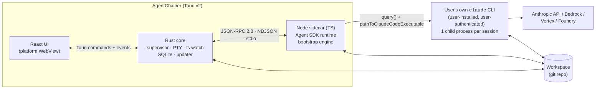
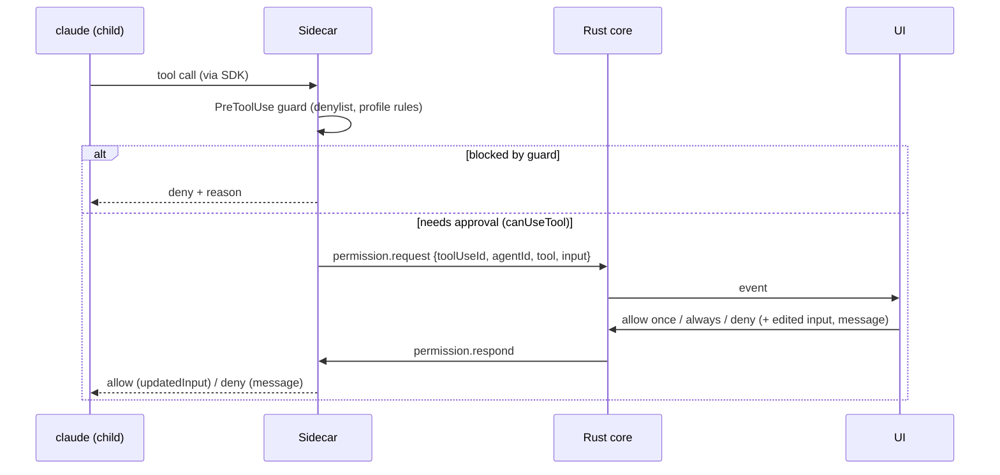
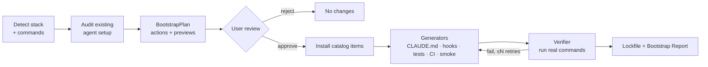

# AgentChainer — Architecture

> Status: **draft for v0.1**. Decisions referenced here are recorded in [`docs/adr/`](adr/). Items marked **(verify)** must
> be confirmed by a spike or doc check before they are implemented.

## 1. Goals and quality attributes

| Attribute | Target |
|---|---|
| Cross-platform parity | Same features on macOS 13+, Windows 10 1809+/11, Ubuntu 22.04+ (Tauri v2 needs WebKitGTK 4.1 **(verify)**; Claude Code's own minimums also apply) |
| No credential handling | The app never implements login, never reads or stores credentials ([ADR-0002](adr/0002-auth-and-branding.md)) |
| Transparency | Every agent action (text, tool call, subagent, permission, cost) is visible as it happens |
| Responsiveness | Token deltas render < 100 ms p95 after the sidecar receives them; UI stays at 60 fps during streaming |
| Resilience | A sidecar or UI crash never loses a session: sessions are persisted by the SDK and resumable |
| Safety | Least privilege by default, a hard denylist for destructive commands, preview before any bootstrap change |
| Evolvability | SDK/CLI churn is absorbed by one normalization layer, covered by recorded-fixture contract tests |

## 2. Process model



| Component | Responsibilities | Does **not** |
|---|---|---|
| **React UI** | Rendering, interaction, local view state | Talk to the sidecar or the network directly |
| **Rust core** | Window and app lifecycle; sidecar supervision; relaying IPC; PTY terminals; file watching; SQLite (app metadata, cost history); updater; opening external editors and terminals | Contain agent logic |
| **Node sidecar** | Agent sessions via the Agent SDK; event normalization; permission brokering; bootstrap engine (detect, plan, install, generate, verify); git via CLI | Persist app state; touch credentials |
| **`claude` CLI** | Model calls, tools, subagents, hooks, skills, MCP; session transcripts; auth | Anything app-specific |

Rationale and alternatives: [ADR-0001](adr/0001-desktop-stack.md), [ADR-0003](adr/0003-agent-runtime-and-ipc.md).

## 3. Locating `claude` and the user's environment

The app relies on the user's installed CLI ([ADR-0002](adr/0002-auth-and-branding.md)), so it must find the CLI and the
env vars the user set (`ANTHROPIC_API_KEY`, `CLAUDE_CODE_USE_BEDROCK`, …).

1. **Resolve the login-shell environment** (macOS/Linux). GUI apps started from Finder or a desktop launcher do **not**
   inherit `~/.zshrc` or `~/.bashrc`. At startup, run `$SHELL -ilc 'env -0'` with a timeout and merge the result into the
   sidecar's env, as VS Code does. On failure, fall back to the process env and show a warning.
2. **Find the binary**, in order:
   - the user override in Settings;
   - `PATH` from the resolved env;
   - known locations: `~/.local/bin/claude`, `/opt/homebrew/bin/claude`, `/usr/local/bin/claude`,
     `%USERPROFILE%\.local\bin\claude.exe`, the npm global prefix, the WinGet shim.
3. **Check the version**: run `claude --version`, parse it, and compare against `MIN_CLAUDE_VERSION` (set in spike S5).
   If it's too old, show "Run `claude update`" (or the package-manager equivalent).
4. **Check auth**: run `claude auth status --json`. We only read the logged-in flag and method or provider; any other fields
   are ignored and never logged. If logged out, show the [AUTH_SETUP](guides/AUTH_SETUP.md) tutorial.
5. **Windows specifics:**
   - Git for Windows is recommended (Claude's Bash tool uses Git Bash; without it, PowerShell is used).
   - A `claude` installed **inside WSL** is not reachable from the Windows app in v0.1. WSL support is a later item **(verify)**.

## 4. IPC protocol (Rust ⇄ sidecar)

- **Framing:** one JSON-RPC 2.0 object per line (UTF-8) on the sidecar's stdin/stdout. stdout carries protocol frames
  only; logs go to stderr, which Rust captures into the log file.
- **Handshake:** `system.hello {protocolVersion, appVersion}` → `{protocolVersion, sdkVersion, nodeVersion}`. On a major mismatch, refuse to start.
- **Schemas:** `packages/protocol` (zod) → JSON Schema → generated TS + Rust types. Both ends validate every frame.
- **Backpressure:** each `text.delta` is forwarded as its own frame. Spike S2 measured p95 2–3 ms from sidecar to UI, so
  ~16 ms coalescing is deferred until measurements show it's needed. Rust forwards frames to the UI as Tauri events.
- **Metrics (dev):** with `AGENTCHAINER_METRICS=1`, notifications carry `ts` (send time). The self-test mode
  (`AGENTCHAINER_SELFTEST`, `scripts/selftest-latency.mjs`) uses it to measure latency without UI clicks.
- **Cancellation:** every long request carries a `requestId`; `request.cancel {requestId}` aborts it.

Planned surface (v0.1):

| Kind | Name | Purpose |
|---|---|---|
| request | `env.check` | Return CLI path, version, auth state (no secrets) |
| request | `debug.log` | Dev only: write a UI line to the sidecar log (self-test metrics) |
| request | `session.start` | Start a session `{workspace, model, effort, mode, profile, budgetUsd, resume?, fork?}` |
| request | `session.send` | Push a user message (text, @files, images) into the streaming input |
| request | `session.interrupt` | Interrupt the running turn |
| request | `session.setMode` | `setPermissionMode()` mid-session |
| request | `session.list` / `session.messages` / `session.rename` / `session.tag` / `session.delete` | SDK session APIs |
| request | `session.rewind` | `rewindFiles(userMessageId)` |
| request | `permission.respond` | Answer a pending permission request |
| request | `workspace.scan` | Detect stack, commands, and audit the setup → `WorkspaceProfile` + findings |
| request | `bootstrap.plan` / `bootstrap.apply` / `bootstrap.rollback` | Bootstrap engine |
| notification | `agent.event` | Normalized `AgentEvent` (see §5.2) |
| notification | `permission.request` | Ask the user to approve a tool call |
| notification | `bootstrap.progress` | Per-action progress, logs and verification results |

## 5. Agent runtime and event model

### 5.1 Session runtime

Each session is one `query()` in **streaming-input mode**: an async iterable we push user messages into. This is what
enables follow-ups, `interrupt()` and `setPermissionMode()`. Key options:

| Option | Value | Why |
|---|---|---|
| `pathToClaudeCodeExecutable` | resolved user binary (§3) | Use the user's install and auth |
| `cwd` | workspace root (or worktree) | Scope |
| `settingSources` | `['user','project','local']` | Load the user's and the project's CLAUDE.md, skills, hooks and settings, like the CLI does |
| `includePartialMessages` | `true` | Token streaming |
| `forwardSubagentText` | `true` | Subagent text and thinking for observability |
| `enableFileCheckpointing` | `true` | Rewind (M1-23) |
| `canUseTool` | broker → UI | Approvals (§6) |
| `hooks` | `PreToolUse` guard; `PostToolUse` (file change tracking, M1) | Safety and observability |
| `permissionMode` | from profile | §6 |
| `model`, `effort`, `maxBudgetUsd` | from settings / session | Cost control |

### 5.2 Normalized events

The SDK's message union (`system/init`, `assistant`, `user`, `stream_event`, `result`, task/hook/status messages, …) is
mapped into a stable internal `AgentEvent` union so the UI never depends on raw SDK shapes:

| AgentEvent | Source |
|---|---|
| `session.started {sessionId, model, tools, skills, slashCommands}` | `system/init` |
| `text.delta`, `thinking.delta` | `stream_event` (main agent only); subagent text via forwarded messages |
| `message.completed` | `assistant` |
| `tool.started {toolUseId, name, input, agentId}` / `tool.completed {toolUseId, ok, output, durationMs}` | `assistant` tool_use / `user` tool_result |
| `agent.started {toolUseId, taskId, description, agentType, depth}` / `agent.text` / `agent.completed {status, summary, tokens, durationMs}` | `system/task_started` / subagent `assistant` messages / `system/task_notification` (spike S4) |
| `permission.requested` / `permission.resolved` | `canUseTool` broker |
| `turn.completed {costUsd, modelUsage, durationMs, numTurns, stopReason, denials}` | `result` |
| `context.compacted` | `system/compact_boundary` |
| `api.retry` | `system/api_retry` |
| `error` | SDK errors / `is_error` results |

In streaming-input mode, `system/init` arrives at the start of **every turn**, not once per session (spike S2), so
consumers must treat `session.started` as idempotent.

**Agent tree:**

- Nodes are agents, keyed by the `tool_use_id` of the Agent tool call that spawned them.
- A message belongs to the main agent when `parent_tool_use_id` is null. Otherwise it belongs to the subagent spawned by
  that tool use. Subagent messages also carry `agent_id`.
- Lifecycle comes from `system/task_started` and `system/task_notification`, which carry the same `tool_use_id`, a
  description, a type, depth, status, summary and usage. Spike S4 showed these are enough; the `SubagentStart/Stop`
  hooks aren't registered.

Every mapping is covered by **recorded fixtures**: real SDK output saved as JSONL in `packages/sidecar/test/fixtures/`.
- Record with `AGENTCHAINER_RECORD_SDK` (or `spike-host --record`), then run `scripts/make-fixture.ts`.
- `make-fixture.ts` drops non-session messages, replaces plain and encoded paths and the username, and refuses to write
  if anything identifying survives.

### 5.3 Cost

- `turn.completed` carries `total_cost_usd` and `modelUsage`; `modelUsage` includes subagents.
- These are client-side **estimates**, and the UI labels them so.
- In streaming mode, totals are cumulative per session, so the app stores per-turn deltas.

## 6. Permissions



- **Why both mechanisms:** `canUseTool` is **not** called for calls already allowed by rules or by the mode, so the
  `PreToolUse` guard is the only place that sees *every* call.
- **Profiles:**

| Profile | SDK mode | Pre-allowed | Always asks |
|---|---|---|---|
| **Safe** (default) | `default` | Read-only tools (Read, Grep, Glob) | Edits, Bash, MCP, web |
| **Standard** | `acceptEdits` | Read-only + edits inside the workspace + allowlisted commands (test/lint/format/build from the WorkspaceProfile) | Other Bash, MCP writes, network |
| **Autonomous** | `auto` (classifier) **(verify availability per account)** | As decided by Claude's auto mode | Guard denylist still applies; budget cap mandatory |

- **Hard denylist** (every profile; regex + parsed-command checks):
  - recursive deletes outside the workspace;
  - `git push --force` to protected branches;
  - `curl|wget … | sh`;
  - credential file reads (`~/.ssh`, `~/.aws`, `.env*` outside the workspace);
  - production deploy commands.
- **"Always allow"** writes a rule to `.claude/settings.local.json` (uncommitted), listed in the Permissions panel.
- Subagents inherit the session's mode.

## 7. Sessions, checkpoints and persistence

- Sessions use SDK APIs only ([ADR-0004](adr/0004-session-data.md)): `listSessions`, `getSessionMessages`, `resume`,
  `forkSession`, `renameSession`, `tagSession`, `deleteSession`. Sessions started in the terminal can be resumed in the app.
- **Checkpoints:** `rewindFiles(userMessageId)`. Known limits are shown in the UI: changes made via Bash, by most
  subagents, and to symlinks are not restored.
- **App DB** (SQLite, owned by the Rust core; migrations versioned):

| Table | Contents |
|---|---|
| `workspaces` | path, display name, last opened, profile hash |
| `session_meta` | sessionId ↔ workspace, created-in (app/cli), pinned |
| `turn_costs` | sessionId, turn index, costUsd, tokens by model, duration |
| `bootstrap_runs` | run ID, workspace, plan summary, result, lockfile hash |
| `settings` | app settings (no secrets) |

## 8. Workspace bootstrap engine



- **Detector** outputs a `WorkspaceProfile`:
  - languages, package managers, frameworks, packages (monorepo-aware);
  - commands (install/build/lint/format/typecheck/test/dev), each with a confidence;
  - existing CI and test framework.
- **Auditor** checks CLAUDE.md/AGENTS.md, `.claude/` (settings, skills, agents, hooks), `.mcp.json`, CI,
  `.gitignore` hygiene and the git remote. Each finding maps to an action.
- **Actions:** `install-skill`, `install-plugin`, `add-mcp`, `write-file`, `merge-file`, `run-command`. Each implements
  `preview()`, `apply()`, `verify()` and `rollback()`.
- **Generators** are agent sessions:
  - They run under a restricted profile: edits inside the workspace only, Bash limited to the detected commands.
  - They use AgentChainer's first-party skills (`skills/ac-*`).
  - They produce **proposals** (diffs) that go through review, and never write directly.
- **Verifier:**
  - Runs the real commands with timeouts and records exit code, duration and log tail.
  - Generators get a bounded number of repair attempts.
  - The Bootstrap Report lists what passed, failed and was skipped, with reasons.
- **Lockfile** `.agentchainer/lock.json` and the trust rules: [ADR-0005](adr/0005-catalog-trust-model.md), [CATALOG.md](CATALOG.md).

## 9. Security model (summary; full threat model is checklist X-01)

| Threat | Control |
|---|---|
| Prompt injection from repo content or web pages leading to destructive commands | Profiles, `PreToolUse` denylist, approvals for Bash outside the allowlist, Claude Code sandboxing where available **(verify SDK option)** |
| Malicious or compromised catalog item | Pinned SHA + hash, trust tiers, reviews, previews, no upstream install scripts ([ADR-0005](adr/0005-catalog-trust-model.md)) |
| Another local process abusing IPC | stdio-only sidecar (no sockets); Tauri capabilities least privilege; sidecar spawned with an argument allowlist |
| Secret leakage via logs or diagnostics | App never handles credentials; redaction filter on logs, diagnostics export and displayed tool output |
| Malicious update | Signed updater manifests; signed binaries where possible |

## 10. Packaging and distribution

- **Sidecar:**
  - Compiled to a single executable per target triple. Candidates are `@yao-pkg/pkg` and Node SEA; spike S1 decides.
  - Shipped via `bundle.externalBin` (`binaries/agentchainer-sidecar-<target-triple>`).
  - Avoid native Node addons in the sidecar.
- **No Claude binary bundled:**
  - Install the SDK with `--omit=optional` so its per-platform CLI packages are not pulled in.
  - The user's CLI is used instead ([ADR-0002](adr/0002-auth-and-branding.md)).
- **Bundles:** dmg (macOS), msi/nsis (Windows), AppImage/deb/rpm (Linux).
- **Signing:**
  - macOS: Developer ID + notarization. Every embedded binary, including the sidecar, must be signed with the hardened
    runtime. Node may need the `allow-jit` entitlement **(verify)**.
  - Windows: Azure Artifact Signing via `signCommand`, or unsigned with SmartScreen guidance. EV certificates no longer bypass SmartScreen.
  - Linux: checksums (+ GPG).
- **Updates:** `tauri-plugin-updater` with signed manifests on GitHub Releases.
- **Open:** SDK redistribution terms (M0-03, [R-11](RISKS.md)).

## 11. Planned repository layout

```text
agentchainer/
├── apps/desktop/
│   ├── src/                  # React UI (Vite, TS strict)
│   └── src-tauri/            # Rust core (Tauri v2), capabilities/, binaries/
├── packages/
│   ├── sidecar/              # Agent SDK runtime, event normalizer, bootstrap engine
│   │   └── test/fixtures/    # recorded SDK event streams
│   └── protocol/             # zod schemas → JSON Schema → TS/Rust types
├── catalog/
│   ├── schema.json
│   ├── items/                # one YAML per skill/plugin/mcp/hook/tool
│   ├── profiles/             # baseline, ts-node, python, flutter, go, security, …
│   └── workflows/            # (M3) workflow templates per tier
├── skills/                   # AgentChainer first-party skills (ac-*)
├── templates/<stack>/        # CI, test, smoke, CLAUDE.md skeletons per stack
├── fixtures/                 # sample repos for bootstrap and e2e tests
├── docs/                     # PRD, ARCHITECTURE, CHECKLIST, ADRs, spikes, guides
└── .github/workflows/
```

## 12. Testing strategy (for AgentChainer itself)

| Layer | Tooling | Notes |
|---|---|---|
| Rust core | `cargo test`, clippy | Supervisor, IPC relay, DB migrations |
| Sidecar | `node:test` (+ built-in coverage) | Normalizer against recorded fixtures; guard; CLI parsing; installers and rollback on temp dirs |
| UI | `node:test` for pure logic (transcript reducer, stats); Vitest + Testing Library once DOM component tests are needed | Driven by a fake transport replaying fixtures. No live model calls in CI |
| Protocol | Generated-type compile checks + schema round-trip tests | Rust ⇄ TS stay in sync |
| E2E | `tauri-driver` (WebDriver) on Linux and Windows | macOS WKWebView has no WebDriver **(verify)**; use a manual checklist there |
| Contract drift | Weekly CI job against the latest SDK + CLI | Opens an issue on mismatch (X-05) |
| Live smoke | Manual or opt-in job with the maintainer's own credentials | Never in PR CI |

## 13. Observability of the app

- Structured logs: Rust `tracing` and the sidecar's stderr, to rotating files in the app data dir.
- "Export diagnostics" bundles logs, versions and the env check, with secrets redacted.
- No telemetry by default (X-04).

## 14. Open questions

| Question | Resolved by |
|---|---|
| `@yao-pkg/pkg` vs Node SEA; final sidecar size and cold start | S1 (M0-15) |
| Event latency through Rust relay | S2 (M0-16) |
| Exact `claude auth status --json` fields; minimum CLI version | S5 (M0-19) |
| Plugin version pinning via marketplace CLI | S6 (M0-20) |
| Auto mode availability per account type | M1-18 |
| Per-subagent stop control | M4-05 |
| WSL-installed CLI support on Windows | post-v0.1 |
