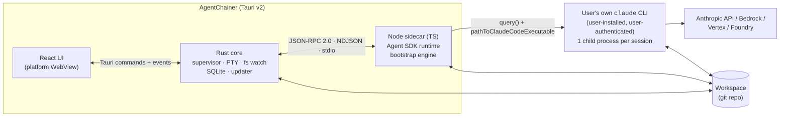
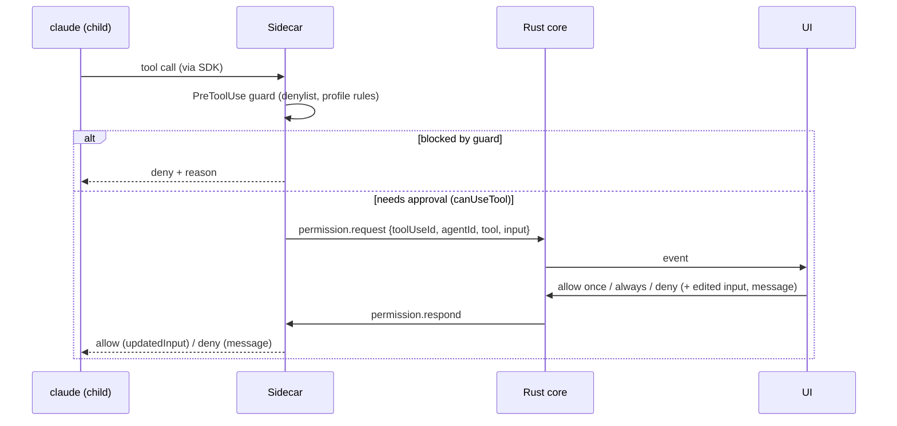
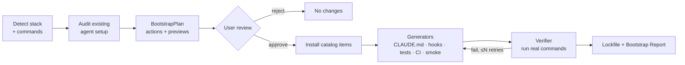

# AgentChainer — Architecture

> Status: **draft for v0.1**. Decisions referenced here are recorded in [`docs/adr/`](adr/). Items marked **(verify)** must
> be confirmed by a spike or doc check before they are implemented.

## 1. Goals and quality attributes

| Attribute | Target |
|---|---|
| Cross-platform parity | Same features on macOS 13+, Windows 10 1809+/11, Ubuntu 22.04+ (Tauri v2 needs WebKitGTK 4.1 **(verify)**; Claude Code's own minimums also apply) |
| No credential handling | The app never implements login, never reads or stores credentials ([ADR-0002](adr/0002-auth-and-branding.md)) |
| Transparency | Every agent action (text, tool call, subagent, permission, cost) is visible as it happens |
| Responsiveness | Token deltas render < 100 ms p95 after the sidecar receives them; UI stays at 60 fps during streaming |
| Resilience | A sidecar or UI crash never loses a session: sessions are persisted by the SDK and resumable |
| Safety | Least privilege by default, a hard denylist for destructive commands, preview before any bootstrap change |
| Evolvability | SDK/CLI churn is absorbed by one normalization layer, covered by recorded-fixture contract tests |

## 2. Process model



| Component | Responsibilities | Does **not** |
|---|---|---|
| **React UI** | Rendering, interaction, local view state | Talk to the sidecar or the network directly |
| **Rust core** | Window and app lifecycle; sidecar supervision; relaying IPC; PTY terminals; file watching; SQLite (app metadata, cost history); updater; opening external editors and terminals | Contain agent logic |
| **Node sidecar** | Agent sessions via the Agent SDK; event normalization; permission brokering; bootstrap engine (detect, plan, install, generate, verify); git via CLI | Persist app state; touch credentials |
| **`claude` CLI** | Model calls, tools, subagents, hooks, skills, MCP; session transcripts; auth | Anything app-specific |

Rationale and alternatives: [ADR-0001](adr/0001-desktop-stack.md), [ADR-0003](adr/0003-agent-runtime-and-ipc.md).

## 3. Locating `claude` and the user's environment

The app relies on the user's installed CLI ([ADR-0002](adr/0002-auth-and-branding.md)), so it must find the CLI and the
env vars the user set (`ANTHROPIC_API_KEY`, `CLAUDE_CODE_USE_BEDROCK`, …).

1. **Resolve the login-shell environment** (macOS/Linux). GUI apps started from Finder or a desktop launcher do **not**
   inherit `~/.zshrc` or `~/.bashrc`. At startup, run `$SHELL -ilc 'env -0'` with a timeout and merge the result into the
   sidecar's env, as VS Code does. On failure, fall back to the process env and show a warning.
2. **Find the binary** (`findClaude()` in `claude.ts`), in order:
   - the "Claude CLI path" setting (passed to the sidecar as `AGENTCHAINER_CLAUDE_PATH`);
   - `PATH` from the resolved env;
   - known locations: `~/.local/bin/claude`, `/opt/homebrew/bin/claude`, `/usr/local/bin/claude`,
     `%USERPROFILE%\.local\bin\claude.exe`, `%APPDATA%\npm`.
   - On Windows, an npm install's `claude.cmd` shim is resolved to the real `claude.exe` (spike S6).
   - Implemented (M1-03): the Rust core runs `$SHELL -ilc` once at startup (5 s timeout) and applies that environment
     to every sidecar spawn.
3. **Check the version**: run `claude --version`, parse it, and compare against `MIN_CLAUDE_VERSION` (set in spike S5).
   If it's too old, show "Run `claude update`" (or the package-manager equivalent).
4. **Check auth**: run `claude auth status --json`. We only read the logged-in flag and method or provider; any other fields
   are ignored and never logged. If logged out, show the [AUTH_SETUP](guides/AUTH_SETUP.md) tutorial.
5. **Windows specifics:**
   - Git for Windows is recommended (Claude's Bash tool uses Git Bash; without it, PowerShell is used).
   - A `claude` installed **inside WSL** is not reachable from the Windows app in v0.1. WSL support is a later item **(verify)**.

## 4. IPC protocol (Rust ⇄ sidecar)

- **Framing:** one JSON-RPC 2.0 object per line (UTF-8) on the sidecar's stdin/stdout. stdout carries protocol frames
  only; logs go to stderr, which Rust captures into the log file.
- **Handshake:** `system.hello {protocolVersion, appVersion}` → `{protocolVersion, sdkVersion, nodeVersion}`. On a major mismatch, refuse to start.
- **Schemas:** `packages/protocol` (zod 4) with types inferred from the schemas.
  - The sidecar validates params and its own results; the UI validates results and notifications.
  - `schema/protocol.schema.json` is exported for docs and non-TS clients.
  - The Rust core relays frames without parsing them, so it has no generated types (M1-02).
- **Backpressure:** each `text.delta` is forwarded as its own frame. Spike S2 measured p95 2–3 ms from sidecar to UI, so
  ~16 ms coalescing is deferred until measurements show it's needed. Rust forwards frames to the UI as Tauri events.
- **Metrics (dev):** with `AGENTCHAINER_METRICS=1`, notifications carry `ts` (send time). The self-test mode
  (`AGENTCHAINER_SELFTEST`, `scripts/selftest-latency.mjs`) uses it to measure latency without UI clicks.
- **Cancellation:** every long request carries a `requestId`; `request.cancel {requestId}` aborts it.

Planned surface (v0.1):

| Kind | Name | Purpose |
|---|---|---|
| request | `system.ping` | Health ping from the UI (M1-01) |
| request | `env.check` | Return CLI path, version, auth state (no secrets) |
| request | `sdk.prepare` | Make the Agent SDK ready: node_modules (dev), or download + verify + cache (packaged) |
| request | `debug.log` | Dev only: write a UI line to the sidecar log (self-test metrics) |
| request | `session.start` | Start or resume a session `{cwd, model?, permissionMode?, resume?}` → `{sessionId}`. Planned: effort, profile, budgetUsd |
| request | `session.send` | Push a user message into the streaming input `{sessionId, text}` → `{messageId}`. Planned: @files, images |
| request | `session.interrupt` | Interrupt the running turn |
| request | `session.setMode` | `setPermissionMode()` mid-session |
| request | `session.setModel` / `session.setEffort` | `setModel()` / `applyFlagSettings({effortLevel})` mid-session |
| request | `session.close` | End a live session (tab closed); the transcript stays resumable |
| request | `session.rewind` | `rewindFiles(messageId, {dryRun})` |
| request | `session.list` / `session.history` / `session.rename` / `session.tag` / `session.delete` / `session.fork` | SDK session APIs on stored sessions `{cwd, sessionId}` |
| request | `session.retention` | `cleanupPeriodDays` only, from the user's effective settings |
| request | `permission.respond` | Answer a pending permission request `{allow, always?, updatedInput?, message?, mode?}` |
| request | `permissions.list` / `permissions.remove` | The `permissions` lists of `.claude/settings.local.json`; nothing else in that file leaves the sidecar |
| request | `workspace.files` | Files under the workspace (tracked + untracked, minus ignored) with git status and branch |
| request | `workspace.diff` | HEAD vs working tree for one file, with its `-U0` hunks |
| request | `workspace.revert` | Revert a file to HEAD (new files are deleted) or one hunk (`git apply -R`), worktree only |
| request | `workspace.gitInit` | `git init`, offered when the workspace isn't a repository |
| request | `git.branches` / `git.switch` / `git.stage` / `git.unstage` / `git.commit` / `git.push` | Git panel (M1-30). `git.branches` includes remote-only branches and a merge in progress; `git.switch` with `track` checks out a remote branch. Push is never forced and runs with `GIT_TERMINAL_PROMPT=0` |
| request | `git.fetch` / `git.pull` | `fetch --all --prune`, and `pull --ff-only` (a diverged branch fails with a message, never an automatic merge). Both with `GIT_TERMINAL_PROMPT=0` |
| request | `git.merge` / `git.abortMerge` | Merge a branch into the current one; conflicts come back as files and leave the merge in progress |
| request | `git.renameBranch` / `git.deleteBranch` | `branch -m`; `branch -d`, or `-D` only with `force` after the user confirms losing unmerged commits |
| request | `git.draftMessage` | Commit message from the staged diff: a one-shot haiku `query()` with `tools: []`, `settingSources: []`, `persistSession: false` |
| request | `task.create` / `task.list` / `task.get` / `task.delete` | Tasks (M3, preview): files in `.agentchainer/tasks/<id>/`, git-ignored ([planner.md](design/planner.md)) |
| request | `task.draft` | A read-only session (Read, Grep, Glob; the generators' hook and the workspace guard) drafts the contract as structured output, then triage runs on it: deterministic signals plus a haiku classification |
| request | `task.retriage` / `task.approve` / `task.revise` | Save an edited draft and triage it again; approve the contract and tier together (refused if the contract changed since triage; another tier needs a reason); reopen for editing |
| request | `task.cancel` | Stops a draft, a triage or a run in progress; a stopped draft or triage fails with `cancelled` (-32007) |
| request | `task.start` / `task.resume` | Runs an approved S or M task (M3-06) in the background, or continues an interrupted run: a session per step, the gates run by the sidecar, fix rounds ([planner.md](design/planner.md) §6–§7) |
| notification | `task.updated` | A run changed: a step started or ended, gates ran, or it ended |
| notification | `task` tag on `agent.event` / `permission.request` | Marks a task step's session, which has no tab: the task page shows its transcript, and its approvals show over any page |
| request | `workspace.scan` | Detect stack, commands, and audit the setup → `WorkspaceProfile` + findings (read-only) |
| request | `workspace.saveProfile` | Write the profile to `.agentchainer/profile.json` |
| request | `bootstrap.plan` | Fixes + catalog items + generators for the workspace, each with a preview (read-only; M2-11) |
| request | `bootstrap.apply` / `bootstrap.runs` / `bootstrap.rollback` | Apply selected actions after re-planning; list runs; roll back a run or one action, byte for byte (M2-13…M2-17). `install` lists actions whose install command the user allowed to run before verification (M2-23) |
| request | `bootstrap.autoApply` | Opt-in, before a new session: applies only recommended first-party and official items and the fixes that add lines; `runId` null when nothing applies (M2-18) |
| request | `bootstrap.generate` | A read-only Claude session proposes files for a generator action; nothing is written (M2-19…M2-26) |
| notification | `agent.event` | `{sessionId, event}`: a normalized `AgentEvent` (see §5.2) |
| notification | `permission.request` | `{sessionId, …}`: ask the user to approve a tool call |

Workspace paths are relative to `cwd`; the sidecar rejects absolute paths and `..` segments. Git runs as the system
`git` CLI. The Rust core adds its own Tauri commands (not sidecar methods) for OS work:

| Command | Purpose |
|---|---|
| `workspace_watch` / `workspace_unwatch` | `notify` watcher; emits `workspace://changed {cwd}` debounced to 300 ms. Ignores `node_modules`, `target`, `.git/objects` and similar; on Linux those folders aren't watched at all (inotify needs one watch per folder) |
| `pty_open` / `pty_write` / `pty_resize` / `pty_close` | Integrated terminal: the user's login shell (PowerShell on Windows) in a `portable-pty` PTY; output as `pty://data {id, data}`, `pty://exit {id}` |
| `open_in_editor` | `code`/`cursor --goto file:line`, `zed file:line`, `idea --line N file`, or the OS default app |
| `cost_record` / `cost_sessions` / `cost_summary` | Local cost history in SQLite (§7) |
| `diagnostics_export` | Redacted diagnostics bundle (versions, settings, readiness, recent log, crash logs) to a user-picked file |

**Multi-session (protocol v2, M1-08):** live-session methods and both notifications carry the SDK session id, so one
sidecar runs every tab's session. The sidecar picks the id of a new session itself (the SDK's `sessionId` option), so
it's known before the first turn; a resumed session keeps its id. Session ids must be UUIDs, so they can't form paths.
| notification | `bootstrap.progress` | Per-action progress, logs and verification results |

## 5. Agent runtime and event model

### 5.1 Session runtime

Each session is one `query()` in **streaming-input mode**: an async iterable we push user messages into. This is what
enables follow-ups, `interrupt()` and `setPermissionMode()`. Key options:

| Option | Value | Why |
|---|---|---|
| `pathToClaudeCodeExecutable` | resolved user binary (§3) | Use the user's install and auth |
| `cwd` | workspace root (or worktree) | Scope |
| `settingSources` | `['user','project','local']` | Load the user's and the project's CLAUDE.md, skills, hooks and settings, like the CLI does |
| `includePartialMessages` | `true` | Token streaming |
| `forwardSubagentText` | `true` | Subagent text and thinking for observability |
| `enableFileCheckpointing` | `true` | Rewind (M1-23) |
| `canUseTool` | broker → UI | Approvals (§6) |
| `hooks` | `PreToolUse` guard; `PostToolUse` (file change tracking, M1) | Safety and observability |
| `permissionMode` | from profile | §6 |
| `model`, `effort`, `maxBudgetUsd` | from settings / session | Cost control |

### 5.2 Normalized events

The SDK's message union (`system/init`, `assistant`, `user`, `stream_event`, `result`, task/hook/status messages, …) is
mapped into a stable internal `AgentEvent` union so the UI never depends on raw SDK shapes:

| AgentEvent | Source |
|---|---|
| `session.started {sessionId, model, tools, skills, slashCommands}` | `system/init` |
| `text.delta`, `thinking.delta` | `stream_event` (main agent only); subagent text via forwarded messages |
| `message.completed` | `assistant` |
| `tool.started {toolUseId, name, input, agentId}` / `tool.completed {toolUseId, ok, output, durationMs}` | `assistant` tool_use / `user` tool_result |
| `agent.started {toolUseId, taskId, description, agentType, depth}` / `agent.text` / `agent.completed {status, summary, tokens, durationMs}` | `system/task_started` / subagent `assistant` messages / `system/task_notification` (spike S4) |
| `permission.requested` / `permission.resolved` | `canUseTool` broker |
| `turn.completed {costUsd, modelUsage, durationMs, numTurns, stopReason, denials}` | `result` |
| `context.compacted` | `system/compact_boundary` |
| `api.retry` | `system/api_retry` |
| `error` | SDK errors / `is_error` results |

In streaming-input mode, `system/init` arrives at the start of **every turn**, not once per session (spike S2), so
consumers must treat `session.started` as idempotent.

**Agent tree:**

- Nodes are agents, keyed by the `tool_use_id` of the Agent tool call that spawned them.
- A message belongs to the main agent when `parent_tool_use_id` is null. Otherwise it belongs to the subagent spawned by
  that tool use. Subagent messages also carry `agent_id`.
- Lifecycle comes from `system/task_started` and `system/task_notification`, which carry the same `tool_use_id`, a
  description, a type, depth, status, summary and usage. Spike S4 showed these are enough; the `SubagentStart/Stop`
  hooks aren't registered.

Every mapping is covered by **recorded fixtures**: real SDK output saved as JSONL in `packages/sidecar/test/fixtures/`.
- Record with `AGENTCHAINER_RECORD_SDK` (or `spike-host --record`), then run `scripts/make-fixture.ts`.
- `make-fixture.ts` drops non-session messages, replaces plain and encoded paths and the username, and refuses to write
  if anything identifying survives.

### 5.3 Cost

- `turn.completed` carries `totalCostUsd` (from `total_cost_usd`); `modelUsage` (includes subagents) is planned.
- These are client-side **estimates**, and the UI labels them so.
- `total_cost_usd` is a **running total** in streaming-input sessions, and a resumed session continues from its saved
  total (SDK 0.3.311 docs; seen live: $0.0071 → $0.0085 → $0.0089 after a resume). The UI derives each turn's cost
  from consecutive totals and shows none for the first turn after a resume, whose earlier total it doesn't know.

## 6. Permissions



- **Why both mechanisms:** `canUseTool` is **not** called for calls already allowed by rules or by the mode, so the
  `PreToolUse` guard is the only place that sees *every* call.
- **Profiles:**

| Profile | SDK mode | Pre-allowed | Always asks |
|---|---|---|---|
| **Safe** (default) | `default` | Read-only tools (Read, Grep, Glob) | Edits, Bash, MCP, web |
| **Standard** | `acceptEdits` | Read-only + edits inside the workspace + allowlisted commands (test/lint/format/build from the WorkspaceProfile) | Other Bash, MCP writes, network |
| **Autonomous** | `auto` (classifier) **(verify availability per account)** | As decided by Claude's auto mode | Guard denylist still applies; budget cap mandatory |

- **Hard denylist** (every profile; regex + parsed-command checks):
  - recursive deletes outside the workspace;
  - `git push --force` to protected branches;
  - `curl|wget … | sh`;
  - credential file reads (`~/.ssh`, `~/.aws`, `.env*` outside the workspace);
  - production deploy commands.
- **The approval dialog** (UX-05, `apps/desktop/src/approval.ts`) explains a request before the user answers:
  - the command, with Claude's own `description`, or the file with a diff of the edit;
  - a risk level (low / review first / high) from fixed rules: deletes, pushes, history rewrites and uploads are high;
    installs, downloads, project scripts and file writes need review; read-only commands are low.
  - It's deterministic: no model call. Claude Code's own `defaultToNo` raises the level to high, and high keeps the
    focus on Deny.
- **"Always allow"** saves the CLI's suggested rule where the user picks. Workspace settings → Permissions lists both
  rule files.
  - The places:
    - this session only (`session`);
    - this workspace for this user (`.claude/settings.local.json`, uncommitted; the default);
    - the workspace for the whole team (`.claude/settings.json`, committed).
  - It returns the CLI's `addRules` / `addDirectories` suggestions as `updatedPermissions`, re-targeted to that
    destination. `setMode` suggestions are left out, so "always" never changes the mode.
  - The CLI escapes `(` and `)` inside saved rule content, e.g. `Bash(node -e "console.log\('x'\)")`.
- **Plan mode:** ExitPlanMode reaches `canUseTool` with `input.plan` (markdown) and `input.planFilePath`.
  - The CLI writes the plan file under `~/.claude/plans/`.
  - Approving returns a `setMode` update for the mode the user picked; in a live run the plan then executed without
    further edit prompts.
  - In one live run, a plan-mode turn cost about 30× a plain haiku turn ($0.17). Planning context is large, so the
    UI's cost display matters there.
- Subagents inherit the session's mode.

## 7. Sessions, checkpoints and persistence

- Sessions use SDK APIs only ([ADR-0004](adr/0004-session-data.md)): `listSessions`, `getSessionMessages`, `resume`,
  `forkSession`, `renameSession`, `tagSession`, `deleteSession`. Sessions started in the terminal can be resumed in the app.
- **Checkpoints:** `enableFileCheckpointing` + `rewindFiles(messageId)`, where `messageId` is the uuid the sidecar
  gives each user message it sends (or the uuid from `getSessionMessages` for earlier ones). The UI previews with
  `dryRun`, then confirms. Known limits are shown in the UI: changes made via Bash, by most subagents, and to symlinks
  are not restored, and the conversation itself is not rewound.
  - Verified live (`spike-host --scenario sessions`): rewinding restores the file to its state before that message,
    rewinding past a file's creation deletes it, and checkpoints still rewind after the session is closed and resumed.
  - `forkSession` copies the conversation but not its checkpoints (SDK docs).
- **App DB**: `agentchainer.db`, SQLite via `rusqlite` (bundled), owned by the Rust core. The schema version is
  `PRAGMA user_version`. Status per table:

| Table | Contents | Status |
|---|---|---|
| `turns` | one row per completed turn: sessionId, cwd, time, running total and this turn's cost, tokens, duration, model, result subtype | Built (M1-33) |
| `workspaces` | path, display name, last opened, profile hash | Planned. Recent workspaces are in `settings.json` for now |
| `session_meta` | sessionId ↔ workspace, created-in (app/cli), pinned | Planned |
| `bootstrap_runs` | run ID, workspace, plan summary, result, lockfile hash | Planned (M2) |

- Settings stay in `settings.json` (no secrets, atomic writes). A table adds nothing for a handful of values.
- A turn's own cost is the difference between consecutive running totals. When the UI doesn't know it (the first
  turn after a resume), the core takes it from the session's last recorded total. Turns of sessions first seen in
  the app after a resume from the terminal stay uncounted, and the UI says so.
- **App log:** `agentchainer.log` in the app log dir, one JSON object per line (`ts`, `level`, `source`, `msg`),
  rotated at 5 MB. It holds core events and the sidecar's stderr. "Export diagnostics" bundles its tail with the
  crash logs after redaction (M1-35).

## 8. Workspace bootstrap engine



- **Detector** outputs a `WorkspaceProfile`:
  - languages, package managers, frameworks, packages (monorepo-aware);
  - commands (install/build/lint/format/typecheck/test/dev), each with a confidence;
  - existing CI and test framework.
  - Built (M2-06/M2-07, `packages/sidecar/src/detect/`). It reads manifests only and runs nothing.
  - Packages come from workspace configs when there are any; all of them combine, so a pnpm UI plus a Cargo core
    is one profile. Configs read: `pnpm-workspace.yaml`, `workspaces` in package.json, `go.work`, Cargo
    `[workspace]`.
  - Without a workspace config, the detector does a shallow scan (depth 2) that skips `fixtures/`, `examples/`,
    `test/` and similar.
  - One folder can yield several stacks (a legacy repo can be Node and Python at once).
  - Commands run in their package's folder. Each has a source (`package.json#scripts.test`, `Makefile`, `go.mod`, …)
    and a confidence.
  - Ranking: the project's own scripts first, then make/just targets, then conventions. npm's placeholder test
    script doesn't count, and bun always goes through `bun run` (`bun test` is bun's own runner).
  - Manifests are read with small purpose-built readers rather than TOML/YAML dependencies.
- **Auditor** checks CLAUDE.md/AGENTS.md, `.claude/` (settings, skills, agents, hooks), `.mcp.json`, CI,
  `.gitignore` hygiene and the git remote. Each finding maps to an action.
  - Built (M2-08/M2-09). Statuses are `ok`, `info`, `warn` or `missing`; anything not `ok` carries a fix action
    id (`generate-claude-md`, `setup-hooks`, `scaffold-tests`, `generate-ci`, `smoke-test`, `fix-gitignore`,
    `untrack-env`, …) for the bootstrap plan.
  - CLAUDE.md staleness signals: over 300 lines, or not mentioning the detected test command.
  - `.env` coverage uses `git check-ignore --no-index`, so it works before any `.env` exists. A committed `.env` is
    flagged.
- **Profile file** (M2-10): `.agentchainer/profile.json`, written on request. It is derived from the repo, so
  `.agentchainer/.gitignore` keeps it out of git. The bootstrap lockfile next to it will be committed.
- **Task files** (M3): `.agentchainer/tasks/<id>/` holds `task.json`, `contract.json` and `triage.json`, also kept out of
  git. They're read back through the protocol's zod schemas, and a task folder that's a symlink or resolves outside
  the workspace is refused.
- **Actions:** `install-skill`, `install-plugin`, `add-mcp`, `write-file`, `merge-file`, `run-command`. Each implements
  `preview()`, `apply()`, `verify()` and `rollback()`.
- **Generators** are agent sessions:
  - They run under a restricted profile: edits inside the workspace only, Bash limited to the detected commands.
  - They use AgentChainer's first-party skills (`skills/ac-*`).
  - They produce **proposals** (diffs) that go through review, and never write directly.
  - Built (M2-19…M2-26, `packages/sidecar/src/bootstrap/generate.ts`):
    - The session gets only Read, Grep, Glob and Bash, and runs without the user's or the project's settings.
    - A `PreToolUse` hook allows reads inside the workspace, the project's own test/lint/typecheck/build commands,
      and `StructuredOutput`.
    - It answers with structured output (`{files, summary}`).
    - Every path must belong to the generator. Checks (and disallowed paths) go back to Claude as feedback, up to
      2 attempts.
    - Proposals live in the sidecar's memory until applied. `bootstrap.generate` creates one; the plan shows it as a
      multi-file diff.
  - **Workspace guard** (`workspace-guard.ts`):
    - Project commands have side effects. pnpm 11, for example, installs before `pnpm run`, rewriting the
      lockfile and creating `pnpm-workspace.yaml`.
    - Generator sessions and verifier runs are wrapped in a guard that snapshots git's view of the workspace and
      reverts every change to git-visible files afterwards. Files the user was already editing are restored from a
      copy.
    - Outside git, generators get no commands.
- **Verifier:**
  - Runs the real commands with timeouts and records exit code, duration and log tail.
  - After apply it runs the test command (scaffold-tests) or the smoke script (smoke-test) asynchronously, inside
    the guard.
  - Results go into the apply result, the run history, and the lockfile's `generated[].verified`.
  - It never rolls back on its own.
  - Generators get a bounded number of repair attempts.
  - The Bootstrap Report lists what passed, failed and was skipped, with reasons.
- **Lockfile** `.agentchainer/lock.json` and the trust rules: [ADR-0005](adr/0005-catalog-trust-model.md), [CATALOG.md](CATALOG.md).

## 9. Security model (summary; full threat model is checklist X-01)

| Threat | Control |
|---|---|
| Prompt injection from repo content or web pages leading to destructive commands | Profiles, `PreToolUse` denylist, approvals for Bash outside the allowlist, Claude Code sandboxing where available **(verify SDK option)** |
| Malicious or compromised catalog item | Pinned SHA + hash, trust tiers, reviews, previews, no upstream install scripts ([ADR-0005](adr/0005-catalog-trust-model.md)) |
| Another local process abusing IPC | stdio-only sidecar (no sockets); Tauri capabilities least privilege; sidecar spawned with an argument allowlist |
| Secret leakage via logs or diagnostics | App never handles credentials; redaction filter on logs, diagnostics export and displayed tool output |
| Malicious update | Signed updater manifests; signed binaries where possible |

## 10. Packaging and distribution

- **Sidecar** (spike S1):
  - `pnpm --filter @agentchainer/sidecar build:sea` bundles our code with esbuild into one CommonJS file (tens of KB).
  - It then builds a **Node SEA** (single executable application) per target triple, about 117 MB on macOS x64 because
    it embeds Node itself. On macOS the universal Node binary is thinned to the host architecture first.
  - Shipped via `bundle.externalBin` (`binaries/agentchainer-sidecar-<target-triple>`). Tauri copies it next to the app
    binary.
  - Release builds run it with `AGENTCHAINER_DATA_DIR` (app data dir) and `NODE_USE_ENV_PROXY=1`. Debug builds run
    `node src/main.ts` unless `AGENTCHAINER_SIDECAR_BIN` is set.
  - Avoid native Node addons in the sidecar.
- **The Agent SDK is not bundled** (M0-03):
  - `sdk-pin.json` (version, npm tarball URL, sha512 integrity) is generated from the lockfile.
  - On first use, `sdk-loader.ts` downloads exactly that tarball into `<app data>/sdk/<version>`, verifies the hash,
    extracts it with the system `tar`, and `import()`s `sdk.mjs`. A Node SEA can import ESM files from disk, as S1
    confirmed.
  - `sdk.mjs` imports only Node built-ins, so one tarball is enough.
- **No Claude binary bundled:**
  - The SDK's per-platform CLI packages are skipped (pnpm `ignoredOptionalDependencies`).
  - The user's CLI is used instead ([ADR-0002](adr/0002-auth-and-branding.md)).
- **Bundles:** dmg (macOS), msi/nsis (Windows), AppImage/deb/rpm (Linux).
- **Signing:**
  - macOS: Developer ID + notarization. Every embedded binary, including the sidecar, must be signed with the hardened
    runtime. Node may need the `allow-jit` entitlement **(verify)**.
  - Windows: Azure Artifact Signing via `signCommand`, or unsigned with SmartScreen guidance. EV certificates no longer bypass SmartScreen.
  - Linux: checksums (+ GPG).
- **Updates:** `tauri-plugin-updater` with signed manifests on GitHub Releases.
- **Open:** SDK redistribution terms (M0-03, [R-11](RISKS.md)).

## 11. Planned repository layout

```text
agentchainer/
├── apps/desktop/
│   ├── src/                  # React UI (Vite, TS strict)
│   └── src-tauri/            # Rust core (Tauri v2), capabilities/, binaries/
├── packages/
│   ├── sidecar/              # Agent SDK runtime, event normalizer, bootstrap engine
│   │   └── test/fixtures/    # recorded SDK event streams
│   └── protocol/             # zod schemas → JSON Schema → TS/Rust types
├── catalog/
│   ├── schema.json
│   ├── items/                # one YAML per skill/plugin/mcp/hook/tool
│   ├── profiles/             # baseline, ts-node, python, flutter, go, security, …
│   └── workflows/            # (M3) workflow templates per tier
├── skills/                   # AgentChainer first-party skills (ac-*)
├── templates/<stack>/        # CI, test, smoke, CLAUDE.md skeletons per stack
├── fixtures/                 # sample repos for bootstrap and e2e tests
├── docs/                     # PRD, ARCHITECTURE, CHECKLIST, ADRs, spikes, guides
└── .github/workflows/
```

## 12. Testing strategy (for AgentChainer itself)

| Layer | Tooling | Notes |
|---|---|---|
| Rust core | `cargo test`, clippy | Supervisor, IPC relay, DB migrations |
| Sidecar | `node:test` (+ built-in coverage) | Normalizer against recorded fixtures; guard; CLI parsing; installers and rollback on temp dirs |
| UI | `node:test` for pure logic (transcript reducer, tabs, diff, fuzzy) and for the RPC client over a fake transport (`rpc-client.test.ts`) replaying the sidecar's event snapshots of recorded fixtures; Vitest + Testing Library once DOM component tests are needed | No live model calls in CI |
| Protocol | Generated-type compile checks + schema round-trip tests | Rust ⇄ TS stay in sync |
| E2E | `tauri-driver` (WebDriver) on Linux and Windows | macOS WKWebView has no WebDriver **(verify)**; use a manual checklist there |
| Contract drift | Weekly CI job against the latest SDK + CLI | Opens an issue on mismatch (X-05) |
| Live smoke | `spike-host` scenarios with the maintainer's own login: `basic`, `mode`, `interrupt`, `guard`, `auto`, `subagents`, `sessions`, `approvals`, `plan`, `fixtures`, `image`, and `exit` (M1 exit criteria E1–E5 on `fixtures/sample-app`) | Never in PR CI |

## 13. Observability of the app

- Structured logs: `agentchainer.log` in the app log dir, one JSON object per line (core events and the sidecar's
  stderr), rotated at 5 MB (§7).
- "Export diagnostics" bundles logs, versions and the env check, with secrets redacted.
- No telemetry by default (X-04).

## 14. Open questions

| Question | Resolved by |
|---|---|
| `@yao-pkg/pkg` vs Node SEA; final sidecar size and cold start | S1 (M0-15) |
| Event latency through Rust relay | S2 (M0-16) |
| Exact `claude auth status --json` fields; minimum CLI version | S5 (M0-19) |
| Plugin version pinning via marketplace CLI | S6 (M0-20) |
| Auto mode availability per account type | M1-18 |
| Per-subagent stop control | M4-05 |
| WSL-installed CLI support on Windows | post-v0.1 |
