# Design: adaptive planner, task contracts and evidence (M3)

- **Status:** Approved (owner, 2026-10-30; decisions in §15). Delivery step 1 (contract and triage) is built behind
  the **Tasks (preview)** setting.
- **Date:** 2026-10-30
- **Covers:** M3-02…M3-10 and the exit criteria M3-E1/E2. Scope source: PRD [F3](../PRD.md#f3--adaptive-planner-task-contracts-and-evidence-p1).
- **Builds on:**
  - the workspace profile and its detected commands (M2-07);
  - the verifier and workspace guard (M2-20, M2-26);
  - the generators' read-only sessions with structured output (M2-19);
  - the approval UI and risk rules (UX-05).

## 1. What problem this solves

Today a session is a conversation: the user asks, Claude works, and "done" is whatever Claude says. F3 turns a request
into a **task** with three properties the chat doesn't have:

1. **A contract.** Before any code changes, what will be done, what counts as done (acceptance criteria) and what is
   out of scope are written down and approved by the user.
2. **Right-sized work.** A typo gets one agent and the gates. A security-relevant change gets a plan, specialist
   reviews and an independent reviewer. The tier is proposed with reasons, and the user can override it.
3. **Evidence.**
   - "Done" means the required gates (format, lint, typecheck, test, smoke) ran after the last change and passed, as
     recorded from real exit codes.
   - Every task ends with a report: what changed and why, which gates ran or didn't, risks, and manual steps.

The product principles this has to honor (PRD §4):
- evidence over claims;
- deterministic gates over "the AI says it's fine";
- least privilege;
- preview before apply.

The model can propose. It never certifies.

**Not in M3:**
- PRs, CI watching and merge gates (M5);
- the live agent graph (M4; M3 emits the events it will need);
- deploys (M6);
- cost analytics (M7).

## 2. The user's flow

```mermaid
stateDiagram-v2
  [*] --> Draft: user describes the task
  Draft --> Proposed: Claude drafts the contract, triage proposes a tier on the draft
  Proposed --> Proposed: the user edits; an edited contract is triaged again
  Proposed --> Ready: the user approves the contract and the tier together
  Ready --> Proposed: Revise
  Ready --> Running: the workflow template for the tier runs
  Running --> Gating: write steps finished
  Gating --> Fixing: a required gate failed and the fix budget is left
  Fixing --> Gating
  Gating --> Reviewing: gates passed (M, L, XL)
  Reviewing --> Fixing: must-fix findings and budget left
  Gating --> Done: gates passed (S)
  Reviewing --> Done
  Gating --> Failed: fix budget used up
  Failed --> AcceptedRisk: the user accepts the risk, with a reason
  Running --> Cancelled
  Done --> [*]
  AcceptedRisk --> [*]
```



1. **New task.** It's next to "New session" (Home, ⌘⇧N, the palette). The user writes the request as they would in
   chat.
2. **Contract and triage, on one screen.**
   - A read-only session drafts a `TaskContract` as structured output. It's grounded in the repo: it reads files
     (Read, Grep, Glob) but can't write.
   - Triage runs on the draft right away. A card next to the contract form shows the proposed tier, the signals
     behind it, and the cheap model's rationale.
   - The user edits the contract and can pick another tier; the override and its reason are recorded. An edited
     contract must be triaged again before approval, so the tier always matches the contract.
   - One approval covers the contract and the tier. Nothing can change files before it. S tasks get a single
     **Approve and run** once tasks can run (step 2); it's why triage runs on the draft (owner, 2026-10-30).
4. **Run.**
   - The tier's workflow runs as a sequence of steps. Each step is its own Claude session, visible in the UI like any
     session, with approvals in the user's profile.
   - The task view shows the steps as a timeline (the M4 graph replaces it later).
5. **Gates and fixes.**
   - The sidecar runs the gates itself, not the model.
   - Failures go back to the implementing session for a bounded number of fix rounds.
6. **Evidence.**
   - The report is built from recorded facts. It's stored with the task and can be exported as markdown.
   - The task shows **Done** only under the M3-10 rule: required gates passed, or the user accepted the risk.

## 3. Task contract (M3-02)

Stored as `contract.json` (schema in `packages/protocol`, zod):

| Field | Type | Notes |
|---|---|---|
| `task` | string | The user's request, verbatim |
| `objective` | string | One or two sentences: the outcome, not the steps |
| `acceptanceCriteria` | `{ id, text, check }[]` | `check` is `gate:<kind>` (proved by a gate, e.g. `gate:test`), `review` (the independent reviewer judges it) or `manual` (the user checks it) |
| `constraints` | string[] | e.g. "no new dependencies", "keep the public API" |
| `outOfScope` | string[] | What the task explicitly won't touch |
| `risks` | string[] | What could go wrong; feeds triage and the report |
| `affectedAreas` | string[] | Workspace paths or globs Claude expects to touch (from reading the repo) |
| `openQuestions` | string[] | What the request leaves undecided. The user settles them by editing the contract |
| `approvedAt` | | Set when the user approves; the contract is read-only after that, except through "Revise". There's no `approvedBy`: the approver is always the local user, and no identity is stored (ADR-0002) |

**Drafting:**
- The draft comes from a read-only session using `outputFormat: { type: "json_schema" }`, the same mechanism the M2
  generators use for structured output.
- The model is the user's default model (§15).
- If the request is too vague for criteria, the draft lists `openQuestions`, and the form shows them first.
- The output is normalized before anyone sees it: criteria are numbered, a check that names a gate the profile has
  no command for becomes `manual`, and areas outside the workspace are dropped.

**Editing:** the form lets the user add, remove and reword every field. A criterion with no `check` is `manual` by
default, so it can't silently count as proved.

## 4. Triage (M3-03)

**Deterministic signals.** All are computed in the sidecar (`tasks/triage.ts`), without a model, and shown on the
triage card. The thresholds are first values, tuned with the benchmark:

| Signal | How | Floor |
|---|---|---|
| Risk keywords | auth, login, password, token, secret, credential, payment, billing, migration, schema, database, infra, deploy, permission, crypto, encryption, as whole words with common endings. Read from the request, objective, criteria, risks and area paths; not from constraints or out-of-scope, which name what the task won't touch | L |
| Breadth | "everywhere", "across the codebase", "migrate", "rename across", "refactor the", … in the request or objective | L |
| Scope | The parts `affectedAreas` span: a monorepo package, or a top-level folder (root files count as one). Test paths don't count: tests sit next to the code they cover. The code graph replaces this when it's available | 2–3 parts: M. 4 or more, or 40+ existing files under the areas: L |
| Repo size | File count from the workspace listing | Above 10 000 files: M |
| Tests exist | The profile has a `test` command | None: a warning; the template adds "write tests first" for M and above |
| New areas | Areas with no existing files | None: listed only |

`delete` from the first keyword list is left out for now, because it would make small clean-ups ("delete an unused
import") L; the labeled benchmark decides whether it comes back. No rule forces XL; only the model or the user picks
it.

**Classification:**
- A cheap model call (Haiku, structured output) gets the contract and the signals, and returns `{ tier, rationale,
  confidence }`.
- The proposed tier is **the higher of the model's tier and the floor the signals set**. For example, a risk keyword
  can't be talked down to S.
- The user's override always wins and is recorded in the evidence.

**Measuring it (M3-E1):**
- `packages/sidecar/scripts/benchmark-triage.ts` runs triage over the 24 tasks in
  `packages/sidecar/test/triage-benchmark.json`, written against `fixtures/` with a contract each. The tiers are
  labeled by a person (the owner) in `label`; until then the script compares with the author's `suggested` tier.
- It reports agreement for the floor alone, the model alone and combined, and a confusion matrix. The target is 80%
  or more; we measure the baseline first, then tune keywords and the prompt. One run costs about $0.02 (Haiku).
- A unit test checks that no rule sets a floor above a task's tier, which catches over-eager keywords.
- **First baseline (2026-10-30), against the suggested tiers:** floor alone 12/24, model alone 19/24, triage 20/24
  (83%). The misses: two small fixes the model called M, and two XL tasks it called L.

## 5. Workflow templates (M3-04) and the agent library (M3-05)

**Templates** live in `catalog/workflows/<tier>.yaml`. They're versioned, validated by zod like catalog items, and
first-party only. A template is a list of steps:

```yaml
id: tier-m
version: 1
steps:
  - id: plan
    role: architect            # an agent from the library
    access: read               # read | write
    inputs: [contract.json]
    outputs: [plan.md]
    limits: { maxTurns: 30, maxBudgetUsd: 0.75 }
  - id: implement
    role: implementer
    access: write
    inputs: [contract.json, plan.md]
    limits: { maxTurns: 80, maxBudgetUsd: 3 }
  - id: gates
    gates: [format, lint, typecheck, test, smoke]   # those the profile has; see §7
    fix: { step: implement, maxRounds: 2, maxBudgetUsd: 1 }
  - id: review
    role: independent-reviewer
    access: read
    fresh: true                # no transcript: only the contract, the diff and gate results
    inputs: [contract.json, diff.patch, gates.json]
    outputs: [review.json]
```

**The tiers, as in the PRD:**

| Tier | Steps | Notes |
|---|---|---|
| S | implement → gates | No plan step; the contract is the plan |
| M | plan → implement → gates → review | |
| L | in parallel: architect, security-reviewer, test-planner (all read-only) → implement → gates → independent review | The parallel group only reads; their outputs merge into `plan.md` |
| XL | split into sub-tasks (each with its own contract, tier and worktree) → per sub-task flow → integration gates | §8 |

**Agent library:**
- Roles: architect, test-planner, security-reviewer, docs-writer, independent-reviewer, implementer.
- Each is a markdown file with a system prompt and frontmatter (tools, model).
- The orchestrator passes them to the SDK as programmatic `agents` / per-step system prompts, so nothing has to be
  installed for tasks to work.
- **Install into project** writes them into `.claude/agents/` through the normal plan and rollback flow, so the same
  roles work from the CLI and other Claude surfaces. Plain files stay the export format (PRD §3).

## 6. The orchestrator (M3-06)

A sidecar module (`packages/sidecar/src/tasks/`) runs a template as a state machine and persists it.

- **One SDK session per step.** Each step is a `query()` with:
  - its role prompt;
  - tools by access: read steps get Read, Grep and Glob plus the profile's check commands; write steps get the normal
    tool set;
  - `maxTurns`/`maxBudgetUsd` from the template, capped by the task budget;
  - the guard hook, and approvals in the user's profile.

  Separate sessions keep budgets, transcripts and costs per step, and give the reviewer a really fresh context.
  Claude may still spawn its own subagents inside a step.
- **Hand-offs are files** in the task folder: `contract.json`, `plan.md`, `review.json`. A step's prompt names its
  inputs, and its outputs are checked to exist (and, for JSON, to validate) before the next step starts.
- **Parallel steps** run concurrently up to a limit (default 3). Only read steps may run in parallel; at most one
  write step runs per working tree at a time.
- **Persistence and resume.**
  - `task.json` holds the state, the current step and the session ids.
  - After an app restart, a task in progress shows as **Interrupted**, with Resume. Resume continues the step's
    session (SDK resume) or re-runs a read step.
- **Budgets.** The task has a total cap (defaults by tier; the user sets it on the triage card). A step that hits its
  cap ends that step; the task then goes to Failed, unless a later step can still run usefully.
- **Cancel** interrupts the running steps and leaves the working tree as it is: rewind and git still work as in
  sessions.

**Protocol:**
- **Requests in step 1:** `task.create`, `task.draft` (contract, then triage), `task.retriage`, `task.approve`,
  `task.revise`, `task.cancel`, `task.list`, `task.get`, `task.delete`.
- **Later steps add** `task.start`, `task.acceptRisk` and `task.exportEvidence`.
- **Events:**
  - `task.updated` carries the state and step changes;
  - step sessions emit the normal agent events, tagged with `taskId` and `stepId`, so the transcript UI and the later
    M4 graph reuse them.

## 7. Gates and the fix loop (M3-08)

**What gates are:**
- Gates come from the workspace profile's detected commands: `format`, `lint`, `typecheck`, `test`, `build`. `smoke`
  joins them when the M2 smoke generator's script exists; this needs a `smoke` command kind, which M3-08 adds.
- Only kinds the profile has become gates. A missing kind is listed in the evidence as **not run: no command
  detected**, never as passed.

**How they run:**
- **The sidecar runs them, never the model.** It uses `runCommand` from the M2 verifier: timeout, exit code, the
  tail of the log, duration.
- **Format** runs in write mode, and the files it changes become part of the task's diff, recorded as "formatted N
  files". The other gates are checks.
- Gates run in order, and every required gate runs after the last change. A fix round re-runs all of them, because a
  fix can break another gate.

**Fix loop:**
- On a failure, the orchestrator resumes the implementer's session with the failing gate, its command, its exit code
  and the end of its log, and asks for a fix.
- Rounds are capped (default 2) and have their own budget.
- When the cap is reached, the task is **Failed** with the last results.

**The independent reviewer's must-fix findings** get one fix round of their own, under the same caps. Other findings
go into the report.

## 8. XL tasks, worktrees and the Workflow tool (M3-07)

**Splitting:**
- An architect step splits the contract into sub-tasks. Each sub-task has its own contract, which the user approves
  as a list, and its own tier.
- Sub-tasks with no dependency on each other run in parallel, each in its own worktree:
  `git worktree add .agentchainer/worktrees/<task>-<n> -b agentchainer/<task>-<n>`.
- Each sub-task runs its tier's flow in its worktree.

**Integration:**
- The sub-task branches merge back in order into a task branch, and the gates run there (integration gates).
- A merge conflict stops the task, shows the conflicting files, and leaves the resolution to the user. In M5 a
  resolve step may be offered.

**The SDK's Workflow tool:**
- It can run multi-agent workflows inside one session. Its availability depends on the user's plan and settings
  (`enableWorkflows`/`disableWorkflows` in the SDK's settings) **(verify per account type)**.
- M3-07 evaluates it as an alternative executor for XL. It's not the base mechanism, because our gates, evidence and
  approvals have to stay deterministic and inspectable.

## 9. Evidence report (M3-09) and "Done" (M3-10)

`evidence.json` is rendered to `evidence.md` and exported on demand. It's **built only from recorded facts**:

| Section | Source |
|---|---|
| Task, contract, tier and why, overrides | `contract.json`, triage record |
| Changed files, with purpose | `git diff --numstat` against the task's base commit. The purpose of each file comes from the implementer's summary; files it doesn't explain are listed as "no explanation" |
| Gates | Every gate run in order: command, exit code, duration, end of log, round. Gates not run, with the reason (no command detected, or skipped by the user) |
| Acceptance criteria | Per criterion: proved by a gate (with the gate run that proved it), judged by the reviewer (with the finding), or **manual: not checked by AgentChainer** |
| Review | The reviewer's findings, with must-fix status |
| Security notes | Guard blocks during the task, high-risk approvals (UX-05 rules), secrets-scan result if gitleaks is installed |
| Remaining risks and manual steps | From the contract's risks and the implementer's summary, marked as Claude's statements |
| Cost and time | Per step and total, labeled as estimates |

**Done (M3-10):**
- A task is **Done** only when every required gate's latest run, after the last change, exited 0.
- Otherwise it can only end as **Failed**, or as **Accepted with risk**: the user clicks it and gives a reason, and
  the report records who, when and why.
- The UI never shows a check mark for a gate that didn't run.

**M3-E2** is checked by a test that re-runs the recorded gate commands for benchmark tasks and compares the exit codes
with the report.

## 10. UI

- **Task view:** a header with the state and tier, then four parts:
  - the contract (collapsible, read-only after approval);
  - the step timeline: each step opens its session's transcript in place;
  - the gates panel: a row per gate with its runs, exit code and log;
  - the evidence report.
- **Sidebar:** tasks are listed with sessions, with a small state badge.
- **Approvals during a task** use the UX-05 dialog, which also says which step and role is asking.
- **Palette:** "New task", "Accept risk…", "Export evidence".

## 11. Security and cost

- **Guard and approvals** apply to every step. Read steps can't write, by their tool list, so the parallel planners in
  L can't conflict.
- **The independent reviewer** sees the contract, the diff and gate results, never the implementer's transcript. That
  limits prompt-injection carry-over and "grading its own homework".
- **Budgets per step and per task:**
  - defaults are S $1, M $3, L $8, and XL $5 per sub-task, to be tuned with the benchmark;
  - running totals are visible;
  - a cap ends the step, as the SDK's `maxBudgetUsd` does today.
- **Task files** live in `.agentchainer/tasks/<id>/`, kept out of git by `.agentchainer/.gitignore` (§15). The
  evidence is exported as markdown, and in M5 it goes into the PR description.

## 12. Testing

- **Unit tests:**
  - contract and template schemas;
  - triage signals and the floor rule;
  - the orchestrator's state machine;
  - the fix loop's caps;
  - evidence building.

  These use the existing stand-in CLI (`bootstrap/fake-cli.ts`) and scripted SDK events, without model calls.
- **Live, opt-in, a few dollars:**
  - the triage benchmark (M3-E1);
  - an S and an M task end to end on `fixtures/ts-pnpm-vite`, with gates and evidence;
  - the M3-E2 re-run check.

## 13. Delivery

Grouped into fewer, larger PRs:

1. **Contract and triage** (M3-02, M3-03):
   - protocol, sidecar, contract form, triage card;
   - the benchmark harness, with the owner labeling the fixture tasks.
2. **Orchestrator, templates, agents and gates** (M3-04, M3-05, M3-06, M3-08): the S and M tiers end to end.
3. **Evidence and Done** (M3-09, M3-10), plus the L tier and the task view polish.
4. **XL** (M3-07): sub-tasks, worktrees, integration gates, and the Workflow tool evaluation.
5. **Exit runs** (M3-E1, M3-E2).

## 14. Alternatives considered

| Option | Why not |
|---|---|
| One long session that spawns role subagents (Task tool) for each phase | Budgets, transcripts and costs per phase would blur; the reviewer wouldn't get a clean context; gates would run inside the model's loop rather than by the app |
| Let the model run the gates and report them | Violates "evidence over claims": results could be paraphrased or skipped. Gates must be the app's own runs |
| The SDK Workflow tool as the main executor | Plan-dependent availability (verify), and less control over approvals, gates and evidence; kept as an XL option |
| Model-only triage | Not explainable, and drifts; the deterministic floor keeps risky tasks from being under-tiered |
| Installing the agent library into every project first | A file write before the first task; programmatic agents work everywhere, and install stays optional |

## 15. Decisions (owner, 2026-10-30) and what's still open

**Decided:**
1. **Task files stay out of git.** `.agentchainer/tasks/` is ignored. Evidence is exported on demand, and in M5 it
   goes into the PR description.
2. **S tasks show their contract.** Approval is a single **Approve and run**.
3. **Models per role:**
   - Haiku for triage;
   - the user's default model for the contract, the planners and the implementer;
   - **Opus for the independent reviewer**, so the check is stronger than the work it checks. The reviewer's step
     budget accounts for the higher price.
4. **Budgets:** S $1, M $3, L $8, XL $5 per sub-task. Fix rounds are capped at 2. These are tuned after the
   benchmark, and the user can change them on the triage card.
5. **Triage runs on the draft,** and one approval covers the contract and the tier (§2).
6. **Preview:** until tasks can run (step 2), New task appears only with **Tasks (preview)** on in Settings, so a
   release from `main` shows nothing half-finished.

**Still open:**
7. **Benchmark labels:** the owner labels the 24 benchmark tasks (`label` in `triage-benchmark.json`) before tuning.
   M3-E1 needs a human reviewer.
8. **Name in the UI:** "Task" is used unless the owner prefers another name.
