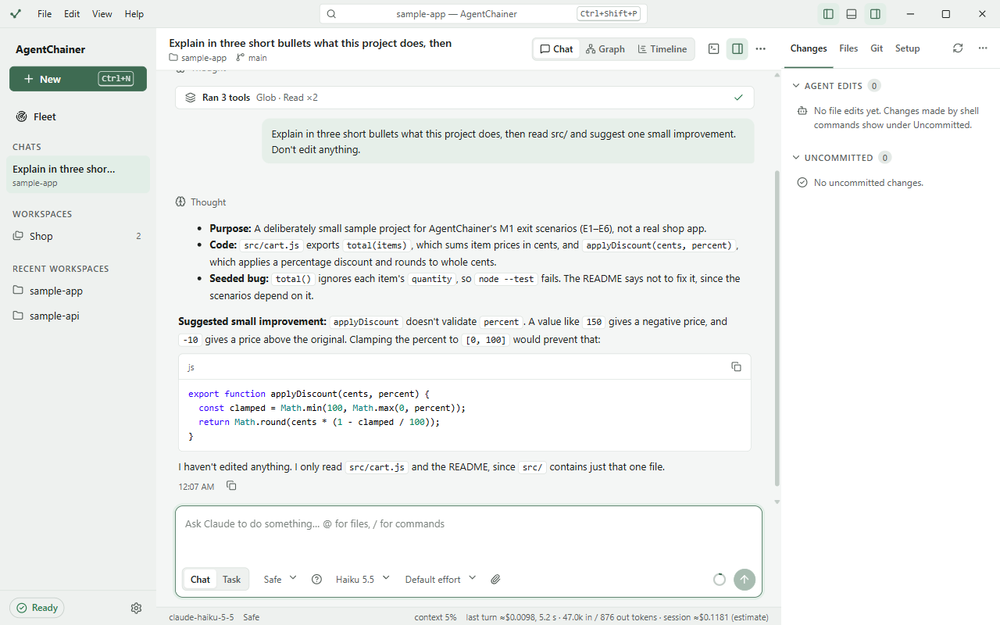
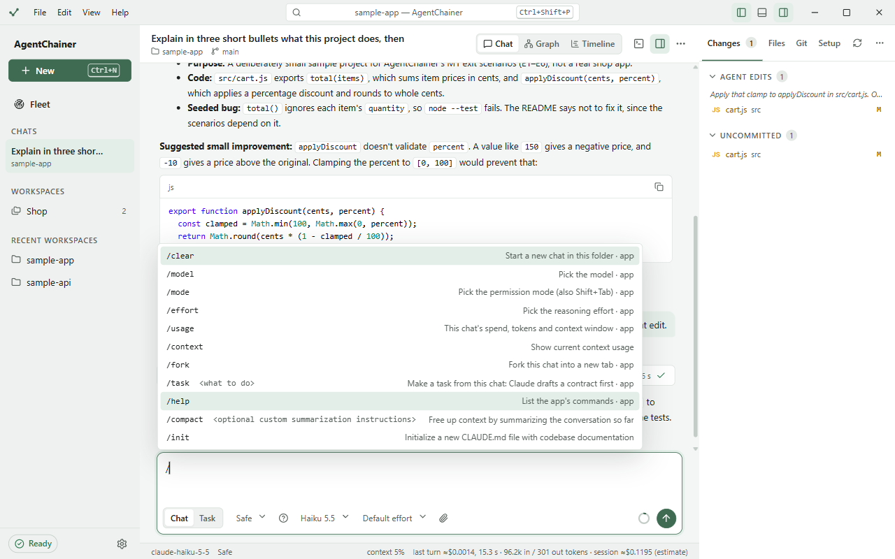

# Chats

A chat is a Claude Code session in a workspace folder. Each open chat is a tab in the sidebar under **Chats**. Start
one with **New** (Ctrl+N) or **Start session** on the start screen.

## The composer

- **Enter** sends; **Shift+Enter** adds a new line. While Claude is working, **Esc** stops the turn.
- Messages you send during a turn are queued and sent after it. You can edit or remove a queued message, or **Send
  now**, which stops the turn first.
- **Chat | Task** chooses what you're sending. A chat message goes straight to Claude. A **Task** starts with a
  contract you approve first (see [Tasks](tasks.md)).
- The selects under the box set the **permission profile**, the **model** and the **effort** for this chat.
- Type `@` to mention a file, or use **Attach files**. You can also drop files on the composer or paste a
  screenshot (up to 5 MB).
- The ring at the right shows how much of the context window is left. Click it to compact the conversation now.
- The status bar shows the model of the last turn, its cost and tokens, and the session's estimated spend.

### `/` commands

Type `/` to see the commands. Those marked **app** are handled by AgentChainer; the rest go to Claude, such as
`/compact` and your own skills.

| Command | What it does |
|---|---|
| `/clear` | Starts a new chat in this folder |
| `/model` | Picks the model, e.g. `/model haiku` |
| `/mode` | Picks the permission profile (also Shift+Tab) |
| `/effort` | Picks the reasoning effort |
| `/usage` | This chat's spend, tokens and context window (also `/cost`, `/stats`) |
| `/fork` | Forks this chat into a new tab |
| `/task <what to do>` | Makes a task from this chat |
| `/help` | Lists the app's commands |

## Questions and plans

- When Claude asks a question, it appears as a card. Pick an answer (number keys work too), type your own under
  **Other**, or **Skip**.
- In **Plan first**, Claude explores read-only and then shows **Review the plan**:
  - **Approve & run**, with **Then run it as** to pick the profile for the work;
  - **Revise**, with the changes you want: Claude updates the plan and asks again;
  - **Reject**.

## Subagents, Graph and Timeline

When Claude starts subagents, they appear as cards in the transcript. The header switches the view:
- **Chat**: the transcript.
- **Graph**: the main agent and its subagents as a tree. Click one to see its prompt, tools, time, tokens, cost and
  result, or **Stop this agent**.
- **Timeline**: one turn at a time, to step through what happened.

The **Terminal** button (Ctrl+J) opens a shell in the workspace folder.

## Team chats

A Team chat lets Claude start **worker sessions** that work in parallel, each in its own tab under the chat, all
under one budget cap.

1. In a new chat, turn on **Team** in the composer.
2. Ask for work that splits well, e.g. "review the API and the UI separately, then summarize".
3. Claude assigns work to workers (up to four at once), messages them, reads their reports and closes them. Each
   worker's tab is nested under the chat in the sidebar. Workers can only read unless Claude gives one write access,
   and a worker's approvals are asked in its own tab.
4. The Team toggle shows the spend so far against the cap. The cap is Settings → **Budget cap per session**, or $2
   if none is set. At the cap, the team stops and its workers close.

Click **Team** again to turn it back into a plain chat.

## Agent profiles

An agent profile runs a chat as one of your agents: its instructions, its model (unless you pick one), and only its
tools.
- Make profiles in Workspace settings → **Agents** ([Workspaces](workspaces.md#agents)). Save one to **This project**
  (`.claude/agents/`, shared through git) or **All my projects** (`~/.claude/agents/`).
- Once there's at least one, the start screen shows **Agent profile**. Pick one before **Start session**.

## Resume, fork and rename

- **Previous sessions** on the start screen lists the folder's sessions, including ones started in the terminal.
  Each has **Resume**, **Fork**, **Rename**, **Tag** and **Delete**.
- A chat whose session ended shows **Resume session** in place of the composer.
- **Fork into a new session** (in the chat's `…` menu, or `/fork`) copies the conversation into a new tab, so you can
  try something else without losing the original.
- Click the chat's title to rename it.

Next: [Tasks](tasks.md).
