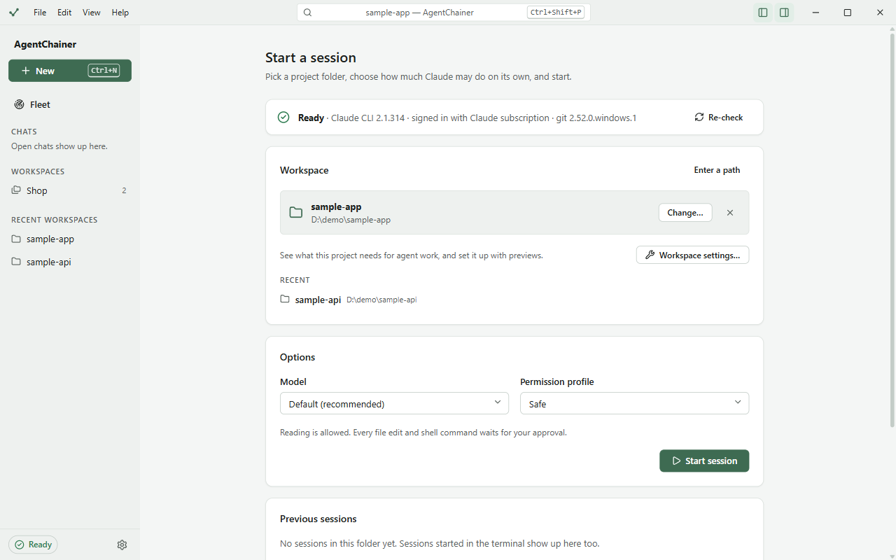
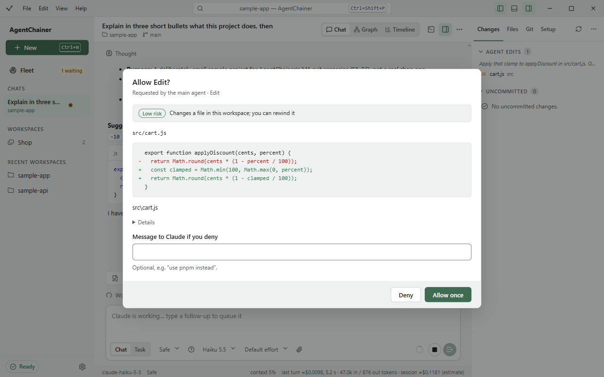
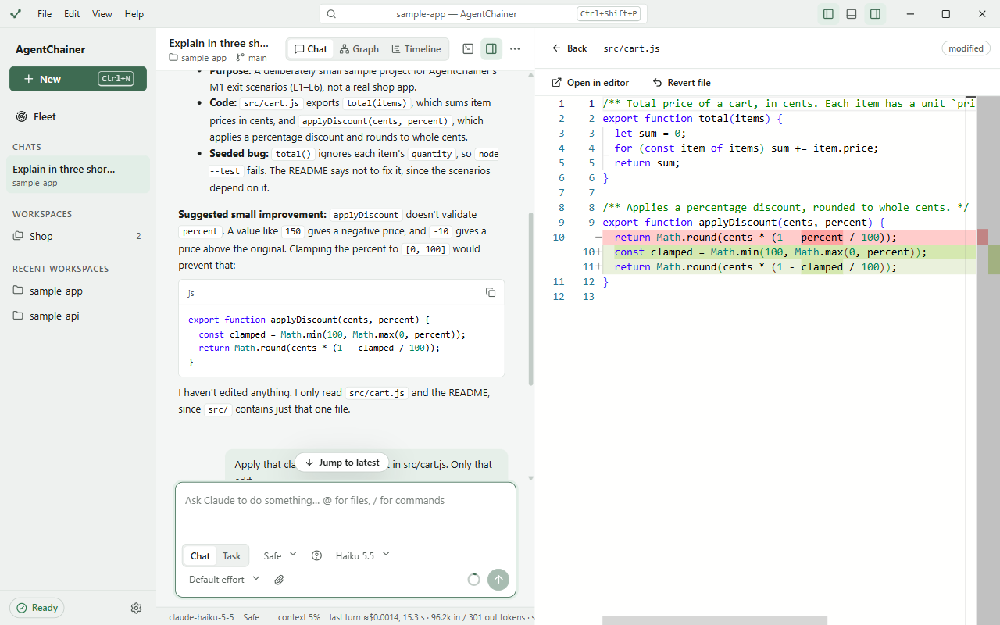

# Getting started

## 1. Install and sign in

1. Install AgentChainer: see the [install guide](../INSTALL.md).
2. Install the Claude Code CLI and sign in to it **in your own terminal**: see [Auth setup](../AUTH_SETUP.md).
   AgentChainer never handles your login, never reads your credentials, and stores no tokens or keys.
3. Open AgentChainer. On first run it downloads the Agent SDK it was built with and checks its checksum. This takes
   a few seconds and happens once.

## 2. The setup check

The top of the start screen shows whether everything is in place:

- **Ready** means the CLI was found, it's new enough, you're signed in, and git is installed.
- If a line says **Missing**, follow the hint on the card, then click **Re-check**. **Open terminal** opens a
  terminal for you to sign in.
- If the CLI is installed somewhere unusual, set **Claude CLI path** in Settings.

## 3. Pick a folder and start

1. Under **Workspace**, click **Open folder…** and pick a project folder, or pick one from **Recent**.
   - Pick a single project, not your whole home folder: the agent stays inside the folder you choose.
   - If the folder isn't a git repository, the app offers **Initialize git here**. Without git, you can't review or
     revert the agent's changes.
2. Under **Options**, choose a **Model** and a **Permission profile** (below). If you've made agent profiles, you
   can also choose an **Agent profile** here ([Chats](chats.md#agent-profiles)).
3. Click **Start session**.

**Workspace settings…** shows what the project still needs for agent work, such as a CLAUDE.md, a linter or tests,
and sets it up with previews. See [Workspaces](workspaces.md#workspace-settings).

## 4. Permission profiles

A profile decides what Claude may do without asking. You can change it at any time from the composer, with
`/mode`, or with Shift+Tab.

| Profile | What it does |
|---|---|
| **Safe** | Reading is allowed. Every file edit and shell command waits for your approval. |
| **Standard** | File edits inside the workspace run without asking. Shell commands, web access and MCP tools still ask. |
| **Autonomous** | Claude's auto mode: a classifier approves or blocks each action, and asks you only when unsure. It needs a budget cap (Settings → **Budget cap per session**). |
| **Plan first** | Claude explores and writes a plan without changing anything. You approve the plan, then pick how to run it. |

In every profile, AgentChainer's guard blocks dangerous commands, such as deleting your home folder or force-pushing.

## 5. Approvals

When Claude wants to do something the profile doesn't allow, the app asks you:

- **Allow once** runs this one action.
- **Deny** refuses it. You can add a **Message to Claude if you deny**, e.g. "use pnpm instead".
- **Always allow** appears when Claude suggests a rule, e.g. for a shell command. You choose where the rule is
  saved:
  - **Only this session**;
  - **This workspace, just me**: saved in `.claude/settings.local.json`, which stays out of git;
  - **This workspace, shared with the team**: saved in `.claude/settings.json`, which is committed.

  You can remove saved rules later in Workspace settings → **Permissions**.
- The badge (**Low risk**, **Review first**, **High risk**) and the line under the title say what the action can
  change. **Details** shows the tool's full input, and **Edit input before allowing** lets you change it first.

A sidebar entry with a dot, and the **waiting** count next to **Fleet**, mean a session is waiting for you.

## 6. See and undo changes

The **Workspace** panel on the right lists the agent's edits:
- **Changes** has the files Claude edited in this session (**Agent edits**) and everything not yet committed
  (**Uncommitted**).
- Click a file to see its diff. **Revert file** undoes it, and **Open in editor** opens it in the editor chosen in
  Settings.

To undo everything since a message, hover the message and click **Rewind files to here**. Only edits made with
Claude's file tools are restored. Changes made by shell commands, and files behind symlinks, are not. The
conversation itself isn't rewound.

The panel also has **Files** (the workspace tree), **Git** (stage, commit, branches, push and pull) and **Setup**
(a summary of the workspace's readiness). Hide the panel with Ctrl+B, or pick its tabs with **Customize tabs** in its
`…` menu.

Next: [Chats](chats.md).
