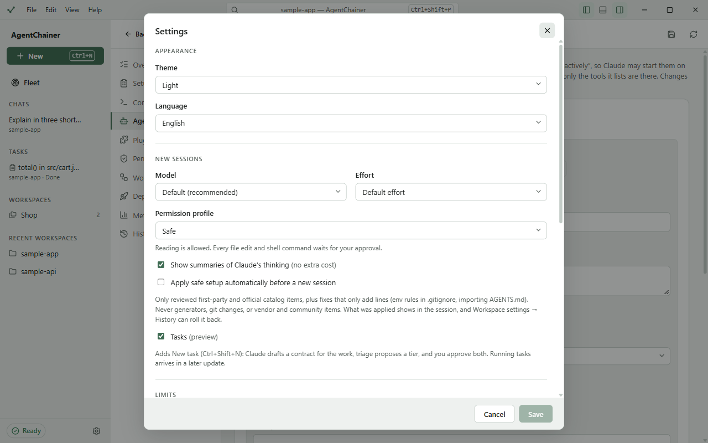

# Settings and privacy

## Settings

Open Settings with the gear at the bottom of the sidebar, **File → Settings…**, or Ctrl+, (⌘, on macOS).

| Section | Setting | What it does |
|---|---|---|
| Appearance | **Theme** | System, Light or Dark. |
| | **Language** | English or Bahasa Indonesia. The app restarts to switch. |
| New sessions | **Model**, **Effort**, **Permission profile** | The defaults for new chats. Each chat can still change them. |
| | **Show summaries of Claude's thinking** | Shows Claude's thinking summaries in the transcript, at no extra cost. |
| | **Apply safe setup automatically before a new session** | Applies only reviewed first-party and official catalog items, plus fixes that only add lines. What was applied shows in the session, and History can roll it back. |
| | **Tasks (preview)** | Turns tasks on ([Tasks](tasks.md)). |
| Limits | **Budget cap per session (USD)** | A session stops when it has spent this much. Leave it empty for no cap. **Autonomous** needs one, and a Team chat uses it as the team's cap. |
| Tools | **Open files in** | The editor that **Open in editor** uses: the system default, VS Code, Cursor, Zed or IntelliJ IDEA. |
| | **Claude CLI path** | Leave it empty to find the CLI automatically. Changing it restarts the agent runtime. |
| About | | The versions of AgentChainer, the Claude CLI, the Agent SDK and Node. **Check for updates…** and **Export diagnostics…** |

Click **Save**. Changes to the model, profile and budget apply to sessions started afterwards.

## Privacy in short

The full statement is [PRIVACY](../../PRIVACY.md). In short:
- **No telemetry, no analytics, no account of its own.** AgentChainer sends nothing about you or your projects
  anywhere.
- **Your login stays with the Claude CLI.** The app never handles your login, reads your credentials, or stores
  tokens or keys. What the CLI sends to Anthropic is between you and the CLI, as you've set it up.
- **What it keeps on your computer:** its settings, a cost history (per turn: time, cost and tokens, never prompts
  or replies), a log with your home folder and secrets masked, and the pinned Agent SDK.
- **In your projects,** it writes only what you apply or approve, plus `.agentchainer/` for backups, run records and
  tasks. Most of it stays out of git.
- **Sessions** are the Claude CLI's own session files. AgentChainer reads them through the Agent SDK and keeps no
  copy.
- **The network:** the SDK download on first run, Claude itself through your CLI, and only what you click: plugins,
  catalog installs, pull requests, deploys, **Check for updates**. It never checks for updates by itself, and an
  update installs only when you click **Install**, after its signature is checked.

## Diagnostics and bug reports

1. **Help → Export Diagnostics…** writes a file to a place you choose. Nothing is uploaded.
2. It holds versions, your settings, the setup check and the recent logs. Your home folder becomes `~`, and keys,
   tokens, passwords and email addresses are masked.
3. **Read it before you share it.** Masking catches common formats, not every possible secret.
4. **Help → Report an Issue** opens a new issue on GitHub, where you can attach the file.

## Menus and shortcuts

On Windows and Linux the menu is in the title bar; on macOS it's the system menu bar, and Ctrl is ⌘.

| Action | Shortcut |
|---|---|
| New session | Ctrl+N |
| New task (when Tasks is on) | Ctrl+Shift+N |
| Open folder | Ctrl+O |
| Close session | Ctrl+W |
| Settings | Ctrl+, |
| Command palette | Ctrl+Shift+P |
| Show or hide the sidebar | Ctrl+\ |
| Show or hide the Workspace panel | Ctrl+B |
| Show or hide the terminal | Ctrl+J |

In the composer, Enter sends, Shift+Enter adds a line, Esc stops the turn, and Shift+Tab cycles the permission
profile.

The **command palette** (Ctrl+Shift+P, or the search box in the title bar) finds commands, open sessions and
folders: e.g. "Fleet", "Theme", "Workspace settings: Plugins", or a session's title.
