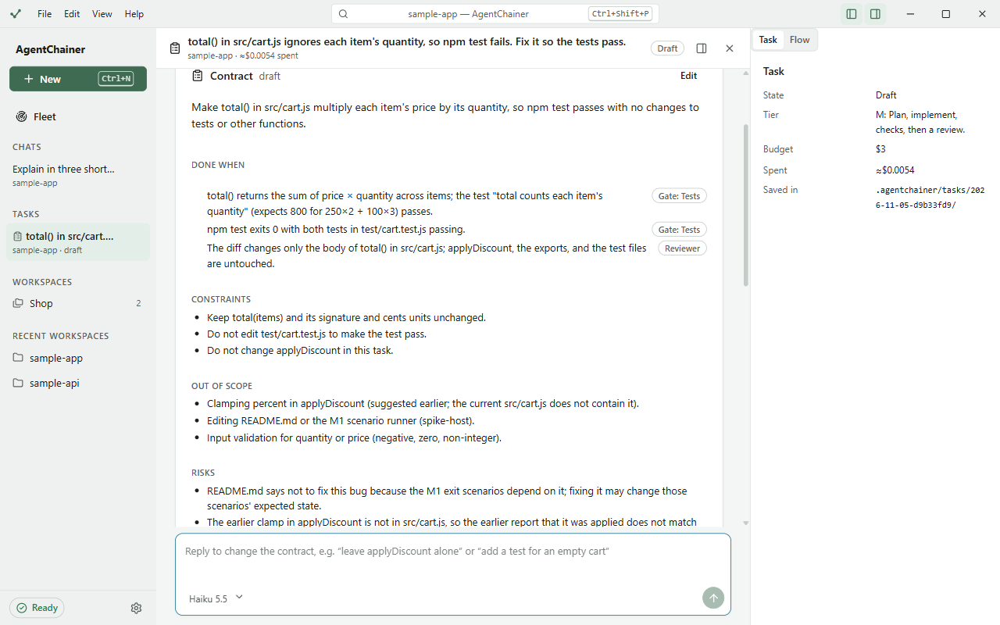
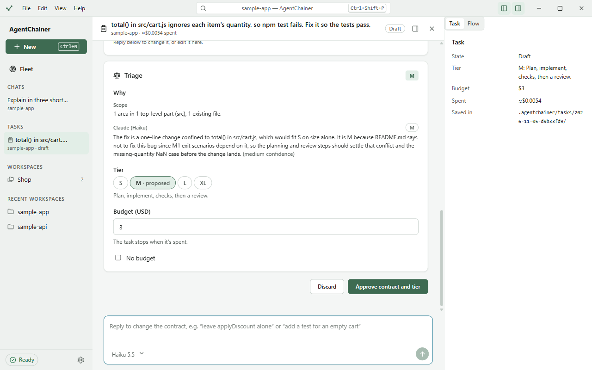
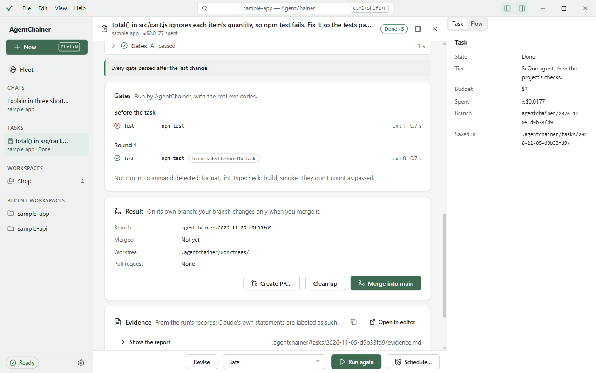
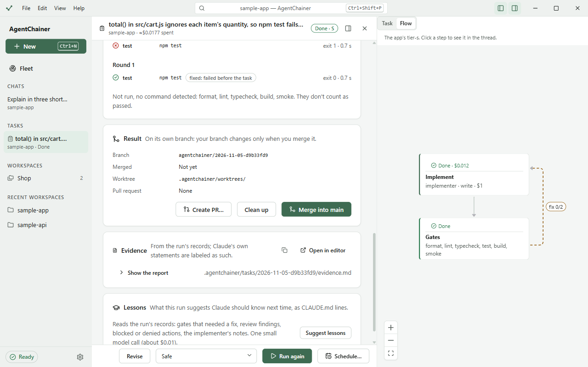
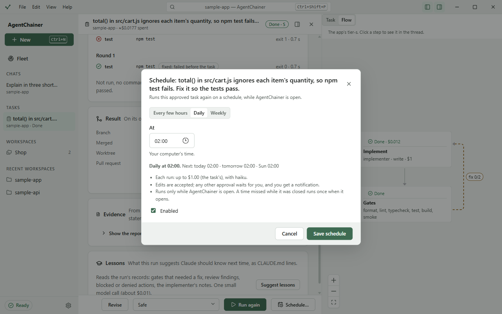

# Tasks

A task is work Claude does against a contract you approve. The app runs your project's own checks on the result,
with their real exit codes, and keeps an evidence report. A task's work happens on its own branch, in its own git
worktree, so your branch changes only when you merge.

Tasks are a **preview** in v0.1. Turn them on in Settings → **Tasks (preview)**.

## 1. Describe the task

Any of these starts one:
- switch the composer to **Task** and describe the work;
- **File → New Task** (Ctrl+Shift+N);
- `/task <what to do>` in a chat, which brings the chat's context along.

The task opens in its own tab under **Tasks** in the sidebar.

## 2. The contract

Claude reads the project (read-only) and drafts a contract:

- **Objective**: what the task achieves.
- **Done when**: the acceptance criteria. Each says how it's checked: **Gate** (proved by a run of your tests or
  linters), **Reviewer** (checked by a review step), or **You check it**.
- **Constraints**, **Out of scope**, **Risks** and **Open questions**.

To change it, reply in the box under the thread, e.g. "leave applyDiscount alone", or click **Edit** to change it
yourself.

## 3. Triage: the tier and budget

Triage proposes a tier from the size and risk of the work, and says why:

| Tier | What runs |
|---|---|
| **S** | One agent, then the project's checks. |
| **M** | Plan, implement, checks, then a review. |
| **L** | Specialist planning, implement, checks, then an independent review. |
| **XL** | Split into sub-tasks, each with its own contract and worktree. |

- To pick a different tier, click it and say why. The reason is recorded with the evidence.
- **Budget (USD)**: the task stops when it's spent. Tick **No budget** for none.
- Click **Approve contract and tier** (for S, **Approve and run**). Nothing runs before you approve.

The select next to **Run** sets the permission profile for the run's write steps. In **Safe**, each edit asks you as
in a chat.

## 4. The run and the gates

The thread shows each step as it runs: the task branch, the gates before the task, then the tier's steps. Type in the
box to message the running step, or click **Stop**.

**Gates** are your project's format, lint, typecheck, test, build and smoke commands, run by AgentChainer itself:

- **Before the task** shows what already failed, so a pre-existing failure isn't blamed on the task, and fixing it
  is marked **fixed: failed before the task**.
- If a gate fails after the change, Claude gets the output and tries again, up to the tier's fix rounds.
- A gate with no command in the project is **not run**, and doesn't count as passed. Workspace settings can add the
  missing ones ([Workspaces](workspaces.md#workspace-settings)).

The task ends as **Done**, **Failed** or **Not verified**. If you accept a result that didn't pass every gate, use
**Accept risk…** and write why. It's then marked **Accepted with risk**.

### The Flow tab

**Flow** draws the tier's workflow, each step with its live state and cost, and the fix rounds used. Click a step to
jump to it in the thread. A project can replace a tier's workflow (Workspace settings → **Workflows**).

## 5. Evidence

The **Evidence** card is a report built from the run's records: the changed files, every gate run with its exit
code, each acceptance criterion and how it was checked, the review, the remaining risks, and the cost and time of
each step. What Claude said about its own work is labeled as Claude's. It's saved as
`.agentchainer/tasks/<task>/evidence.md`. **Show the report**, copy it as markdown, or **Open in editor**.

## 6. Merge or open a pull request

The **Result** card shows the task's branch and worktree:
- **Merge into main** (or your branch) merges it locally.
- **Create PR…** pushes the branch and opens a pull request with the contract and evidence in its body. It needs the
  GitHub CLI, signed in by you ([GitHub setup](../GITHUB_SETUP.md)). Afterwards the **Checks** card follows CI, and
  **Fix CI…** asks Claude to fix a failing run. Merge gates (**Check the gates**, **Review the PR**, **Merge…**)
  check the PR before you merge it on GitHub.
- **Clean up** removes the worktree once you're done.

## 7. Deploy a preview

If the project deploys with Vercel, Cloudflare Workers, Firebase, Fly.io or Docker, the **Deploy** card deploys the
task's branch as a preview, with the provider's own CLI and your own login to it. Production deploys live in
Workspace settings → **Deploy**, and ask you to type the project name first.

## 8. Lessons

**Lessons** suggests lines for CLAUDE.md from what the run went through: gates that needed a fix, review findings,
denied actions. **Suggest lessons** is one small model call (about $0.01). You pick which lines to **Add to
CLAUDE.md**. Adding them is a setup run, so Workspace settings → **History** can roll it back.

## 9. Run it on a schedule

An approved task can run again on a schedule, e.g. a nightly dependency check. XL tasks and sub-tasks can't, since
each split needs your approval. Click **Schedule…**:

- Pick **Every few hours**, **Daily** or **Weekly**, and a time.
- Each run uses the task's budget and the model of its last run. Edits are accepted on their own; any other approval
  waits for you, with a notification.
- Runs happen only while AgentChainer is open. A time missed while it was closed runs once when it opens.
- The **Fleet** lists the schedules under **Scheduled**, with **Run now**, an on/off switch, edit and delete. They're
  saved in `.agentchainer/schedules.json`.

## XL tasks

An XL task is split into sub-tasks, each with its own contract, tier and worktree. Review them in **Sub-tasks** and
**Approve all**. They run in dependency order, two at once, and are merged back into the XL task's branch, where the
gates run once more. Open one with **Open sub-task**. If the run stops or fails partway, **Continue** picks it up
where it was.

Next: [Workspaces](workspaces.md).
