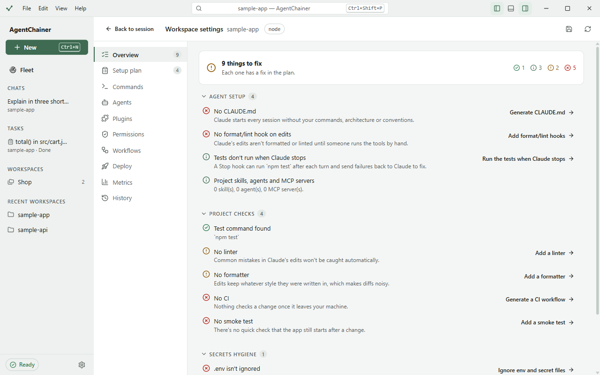
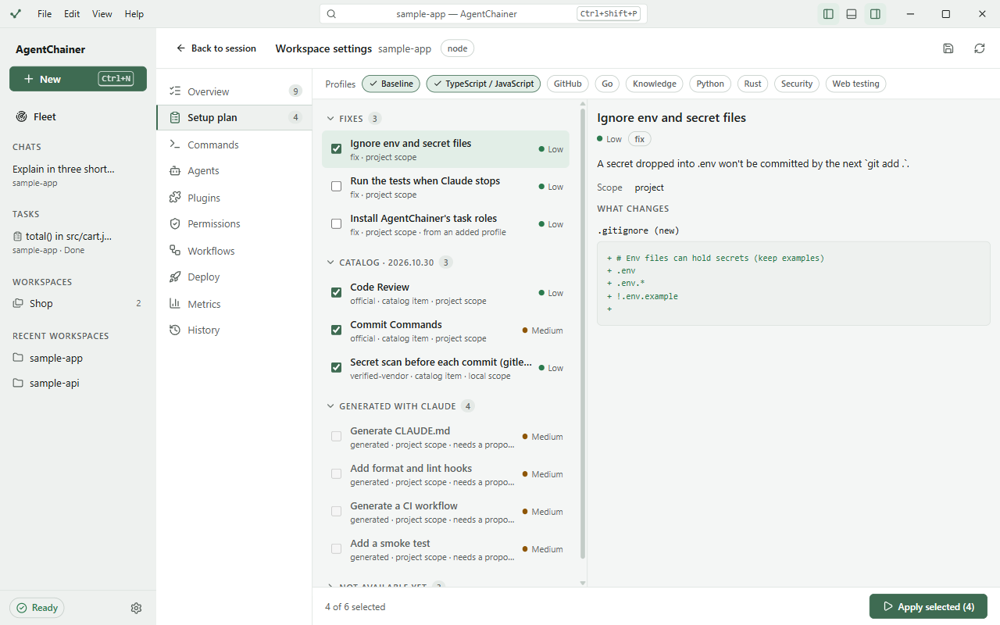
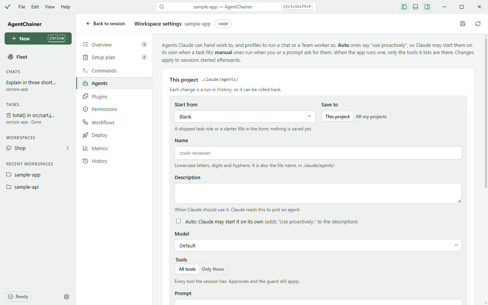
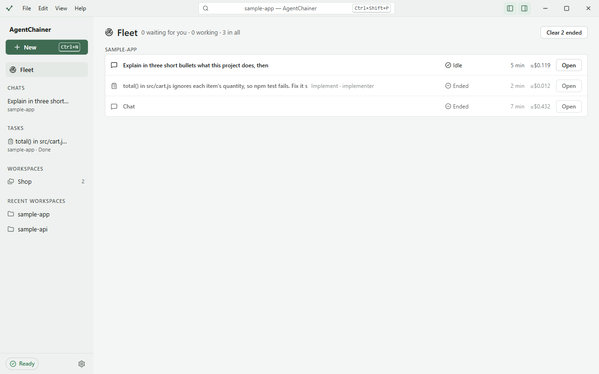

# Workspaces

A workspace is the folder a session works in. It can also be a named set of folders, such as an app and its API.

## Folders

- Pick a folder on the start screen with **Open folder…**, or from **Recent**. The sidebar keeps your recent
  folders under **Recent workspaces**.
- In **Safe** and **Standard**, an edit outside the workspace waits for your approval.

## Multi-folder workspaces

1. On the start screen, under **Workspaces**, click **New workspace…**
2. Give it a **Name** (e.g. Shop), **Choose the primary folder…**, then **Add a folder…** for each of the others.
3. Click **Save workspace**. It appears under **Workspaces** in the sidebar. Click it to start a session there.

A session in it can read and edit all of its folders. Only the **primary** folder's CLAUDE.md, project settings,
hooks and skills apply. When you resume or fork such a session later, it reaches the same folders again. Edit or
remove a workspace with **Edit…** and **Remove**.

## Workspace settings

**Workspace settings** shows what a project needs for agent work and sets it up, always with a preview first. Open it
from the start screen, a chat's `…` menu, or the command palette (Ctrl+Shift+P, "Workspace settings").

### Overview

A readiness check by area: **Agent setup**, **Project checks**, **Secrets hygiene** and **Git**. Each finding says
why it matters and links to its fix in the setup plan.

### Setup plan

The fixes for what Overview found, as a list you pick from:

1. **Profiles** at the top add groups of items for your stack, e.g. TypeScript / JavaScript or Python.
2. Tick the items you want. Click one to see **What changes**: the exact files and lines.
   - **Fixes** are small changes, e.g. ignoring `.env` files.
   - **Catalog** items are skills, plugins and MCP servers that AgentChainer reviewed and pinned to an exact
     version ([CATALOG](../../CATALOG.md)).
   - **Generated with Claude** items, such as a CLAUDE.md or a CI workflow, need a proposal first: click **Generate
     proposal**, then review it.
3. Click **Apply selected**. Every apply is a run in **History**, which can roll it back.

**Rescan** checks the project again. **Save profile** saves your choices in `.agentchainer/profile.json`, which stays
out of git.

### Commands

The build, test, lint and format commands found in the project. Tasks run these as their gates.

### Agents

Subagents Claude can hand work to, and profiles you can run a chat as ([Chats](chats.md#agent-profiles)).

1. Click **New agent**. **Start from** a blank form, a starter, or one of the app's task roles.
2. **Save to** **This project** (`.claude/agents/`) or **All my projects** (`~/.claude/agents/`).
3. Fill in the **Name** and a **Description** of when Claude should use it. Tick **Auto** to let Claude start it on its
   own.
4. Pick the **Model**, the **Tools** (all, or only some), and write its **Prompt**.
5. Click **Create agent**. It applies to sessions started afterwards.

### Plugins

Browse the official plugin marketplace. **Reviewed** plugins were checked by AgentChainer; **Not reviewed** ones are
marked as such. Tick **Reviewed only** to hide the rest. **Install…** asks whether to install for **Just me** or
**The team**. **Installed** lists what's there, with **Update**, **Turn off** and **Uninstall**.

### Permissions

The rules saved with **Always allow**, and any "always ask" or "always deny" rules, split into **Just me** and **Shared
with the team**. **Remove rule** deletes one.

### Workflows

The steps each task tier runs. A project can replace a tier's workflow with its own
`.agentchainer/workflows/<tier>.yaml`, shared through git. **Edit** opens it as a **Canvas** or as **YAML**; you
can also **Generate with AI**, **Import a workflow file** or **Export as a file**.

### Deploy

Production deploys of the current branch, with the provider's own CLI (Vercel, Cloudflare Workers, Firebase, Fly.io
or Docker) and your own login to it. **Deploy to production…** and **Roll back…** ask you to type the project name
first. **History** lists past deploys.

### Metrics

Task statistics on your computer: gate pass rate, cost per task and per successful task, run time, retries, and how
often a task needed you. Filter by time and tier; see them **By tier** and **By workflow**.

### History

Every setup run: what it changed and when. **Roll back run** undoes one and restores the files it changed, byte for
byte. Files you edited since are left alone; **Force rollback** restores them anyway.

## The Fleet

**Fleet** in the sidebar shows everything running, across workspaces: chats, tasks, task steps and Team workers.

- The top line counts what's **waiting for you**, what's **working**, and everything.
- **Answer** opens a session that waits for an approval or a question. **Open** opens any other one.
  **Stop the turn** and **Stop the task** stop work.
- **Clear ended** removes ended ones from the list.
- **Scheduled** lists task schedules ([Tasks](tasks.md#9-run-it-on-a-schedule)).

Next: [Settings and privacy](settings-and-privacy.md).
